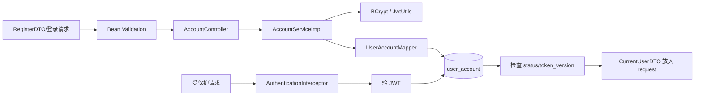

# F01 从 0 做方案：账号、登录与鉴权

> 这份文档不从现成代码出发，而是假设项目里还没有 F01，由你负责把“陌生访客”变成“可信当前用户”。阅读代码链请配合同目录 `NeedToUnderstandingF01.md`。

## 1. 为什么论坛必须先做 F01

没有账号系统时，论坛只能匿名浏览。发帖、点赞、私信和后台治理都会遇到同一个问题：**服务器不知道请求者是谁**。因此 F01 不是一个孤立的登录页，而是 F02-F11 的身份地基。

第一版要交付：注册、登录、查询本人、修改密码、联系方式、管理员处理找回请求。暂不做第三方登录、短信验证码、刷新令牌和自助注销。

## 2. 从零开始会遇到的设计问题

1. **账号、邮箱、手机号怎样保证不重复？**  
   **本项目回答：** Service 先查重以返回可读的 409 提示，数据库再用 UNIQUE 约束做最终防线。前者负责体验，后者负责并发正确性。
2. **两个人同时注册相同账号，“先查再插”还能挡住吗？**  
   **本项目回答：** 挡不住竞态；两次查询可能都看见不存在。最终由 UNIQUE 只允许一个 INSERT 成功，另一个请求把约束异常转换成冲突响应。
3. **密码怎样保存，数据库管理员能不能看到明文？**  
   **本项目回答：** 使用 BCrypt cost 10 保存带随机盐的哈希，只通过 `matches` 校验，数据库没有明文。管理员仍能替换哈希，因此数据库权限和审计仍重要。
4. **登录后服务器怎样识别后续请求？**  
   **本项目回答：** 登录成功签发短期 JWT；客户端在 Authorization Bearer 中携带，`AuthenticationInterceptor` 验签并构造可信 `CurrentUserDTO`。
5. **改密码、封禁、降权后怎样让旧 JWT 立刻失效？**  
   **本项目回答：** JWT 带 `ver`，数据库保存 `token_version`。拦截器每次比较两者；安全状态改变时递增数据库版本，旧 token 随即失效。
6. **客户端传 `userId=1&role=ADMIN` 能不能相信？**  
   **本项目回答：** 不能。业务身份只取自拦截器写入 request 的 `CurrentUserDTO`，角色还要以数据库当前值为准。
7. **账号不存在和密码错误是否返回不同提示？**  
   **本项目回答：** 登录统一返回“账号或密码错误”，避免攻击者枚举账号；注册查重则可以明确提示冲突，因为用户本来就在申请该标识。
8. **找回密码怎样避免任何人替别人重置？**  
   **本项目回答：** 当前走申请记录和管理员批准链，不允许普通请求直接指定别人并改密；不过安全的一次性找回链接与可靠通知仍是待办。
9. **401、403、409 和 400 怎样区分？**  
   **本项目回答：** 无有效身份是 401，身份有效但无权限是 403，唯一键/状态竞争是 409，字段格式错误是 400，由统一异常处理器输出稳定 JSON。
10. **登录暴力尝试怎么办？当前版本解决了吗？**  
    **本项目回答：** BCrypt 提高单次猜测成本，但当前没有 IP/账号维度限流、失败锁定和告警，所以只能算部分防护，公开部署前必须补齐。

## 3. 先定数据和信任边界

`user_account` 保存账号凭证和治理状态，`user_profile` 留给 F02。拆表的原因是密码哈希、角色、状态不应跟公开昵称一起返回。

关键字段：

- `account/email/mobile`：唯一登录标识，数据库 UNIQUE 是最终防线。
- `password_hash`：只保存 BCrypt 结果，不保存原密码。
- `role`：`USER/ADMIN`，只能由可信后端和管理功能修改。
- `status`：`NORMAL/MUTED/BANNED`，登录和发内容时再次校验。
- `token_version`：账号安全版本；改密、封禁等操作递增它。

信任规则只有一句：**身份来自后端验过的 token 和数据库，不来自 URL、JSON 或 LocalStorage 里的 userId/role。**

## 4. 实际方案怎样工作

注册时先标准化账号和邮箱、主动查重，再依赖 UNIQUE 兜住并发；登录时统一返回“账号或密码错误”；受保护请求每次经过拦截器，令牌版本必须与数据库一致。

## 5. 技术选型：用了什么，为什么不用同类方案

| 需要解决的部分 | 当前选择 | 为什么选 | 没选什么，为什么 |
| --- | --- | --- | --- |
| Web 接口 | Spring MVC | 项目本身是 Spring Boot；Controller/DTO 易学习 | WebFlux 适合高并发异步链，但此处数据库仍是阻塞式，增加复杂度没有收益 |
| 参数格式 | Bean Validation | 规则贴近 DTO，错误可统一转换 | 全在 Service 手写 if 会重复；前端校验不能作为安全边界 |
| 数据访问 | MyBatis-Plus | 单表 CRUD 和条件更新简洁 | JPA 隐式行为更多；纯 JDBC 对 F01 样板代码较多 |
| 密码摘要 | BCrypt cost 10 | 自带随机盐、专为密码设计、Spring 直接支持 | MD5/SHA 太快；Argon2 更强但部署参数和内存成本更高，教学版先用 BCrypt |
| 登录状态 | 短期 JWT | 前后端分离容易携带，多个接口共享 | HttpSession 更易撤销但依赖服务端会话；本项目希望练无状态令牌 |
| 统一鉴权 | HandlerInterceptor | 比在每个 Controller 复制校验更集中、直观 | 完整 Spring Security 更成熟，但初学阶段过滤器链和配置成本更高 |
| 令牌撤销 | `token_version` + DB 查询 | 改密、封禁、改角色后旧 token 可失效 | 纯 JWT 到期前无法撤销；Redis 黑名单又增加外部依赖 |
| 并发改密 | 条件更新 `id + old token_version` | 类似乐观锁，影响行数能发现竞争 | 悲观锁会占数据库锁；当前冲突概率低，不值得串行化所有请求 |
| 重复注册 | 主动查重 + UNIQUE | 前者给友好提示，后者保证并发正确性 | 只“先查再插”有竞态；分布式锁比数据库约束更复杂且不应成为唯一防线 |

## 6. 每项技术具体实现了哪一部分

- `RegisterDTO/LoginDTO/ResetPasswordDTO`：只负责输入形状和格式，不负责查数据库。
- `AccountServiceImpl`：注册标准化、登录凭证判断、账号状态、改密事务和并发冲突。
- `PasswordEncoder`：`encode` 生成哈希，`matches` 比较明文与哈希。
- `JwtUtils`：写入 `sub/role/ver/iat/exp` 并签名；JWT 是签名，不是加密。
- `AuthenticationInterceptor`：解析 Bearer token、查询账号、比较版本、生成可信 `CurrentUserDTO`。
- `WebMvcConfig`：声明哪些 `/api/**` 必须登录。
- `UserAccountMapper`：操作 `user_account`，条件更新承担最后的并发判断。
- `GlobalExceptionHandler`：把验证失败、401、403、409 变成稳定 JSON。
- `AccountApiTest/AccountRecoveryApiTest`：验证注册登录、重复数据、旧 token 失效和管理员找回流程。

## 7. 技术带来的后果和缺陷台账

| 缺陷/后果 | 当前状态 | 怎么处理或为什么可暂留 |
| --- | --- | --- |
| JWT 一旦签发本来不能主动撤销 | **已缓解** | 每次请求查 `token_version`；牺牲一部分“完全无状态”换取可撤销 |
| 每个请求查一次账号表 | **可接受** | 当前规模小且能实时检查封禁；以后可短 TTL 缓存，但必须处理失效 |
| 没有 refresh token | **暂留** | 令牌两小时过期，学习版可重新登录；生产端需 access/refresh 双令牌及轮换 |
| token 放 LocalStorage，有 XSS 窃取风险 | **未解决** | 后端已有内容清洗，但不能证明绝无 XSS；生产可考虑 HttpOnly Secure Cookie + CSRF 防护 |
| 自定义拦截器不如 Spring Security 完整 | **可接受** | 已覆盖本项目认证；缺少成熟的 CSRF、方法级授权、认证事件等能力 |
| 登录/重置请求没有限流 | **未解决** | 小型本地项目暂留；公开部署前必须加 IP/账号限流、审计和告警 |
| BCrypt cost 10 会消耗 CPU | **预期成本** | 这是抗暴力破解的目标；上线前压测后调整 cost，不能为快改回 MD5 |
| 默认 JWT secret 适合本地而非生产 | **已提供覆盖方式** | 生产必须用环境变量替换并轮换，不能使用仓库默认值 |
| 管理员批准找回后产生临时密码的交付方式不完整 | **未解决** | 当前只演示后端状态变化；真实系统需一次性链接/可靠通知且不可记录明文 |

## 8. 如果继续演进，顺序是什么

1. 先加登录失败次数、限流和审计，不急着上 OAuth2。
2. 将 token 从 LocalStorage 迁移到 HttpOnly Cookie 时，同时设计 CSRF。
3. 引入 refresh token 表，保存哈希并支持单设备撤销和轮换检测。
4. 权限规则增多后再迁移 Spring Security，保留 Service 业务授权。
5. 接第三方登录时，用独立 `identity_provider` 表关联本地账号，不让第三方 subject 直接成为论坛 userId。

## 9. 面试官最容易追问

**问：已经用 JWT，为什么拦截器还查数据库？** 纯 JWT 快但到期前无法感知改密、封禁和降权。本项目用一次账号查询比较 `token_version/status`，主动接受查询成本换即时安全状态。

**问：注册前已经查重，为什么还要 UNIQUE？** 先查只改善提示，两个并发请求都可能看到“不存在”；唯一约束才是原子最终防线。

**问：为什么不用 Spring Security？** 当前目标是让认证链对初学者可见，拦截器足够覆盖现有路由；公开生产系统应评估迁移，因为 Security 提供更成熟的过滤器链、方法授权和安全防护。

**问：JWT 里放 role 是否就能授权？** 不能只信 token 中的旧 role。本项目每次查数据库并比较版本；角色变更时应递增版本，否则令牌角色可能过时。

### 9.1 面试官还能怎样继续追问

**延伸：JWT 和 Session 怎样选择？** JWT 适合跨服务传递声明，但撤销、续签和密钥轮换更复杂；Session 易于服务端撤销，却需要共享会话或粘性路由。本项目不是“JWT 一定更好”，而是用 tokenVersion 补足即时撤销。

**延伸：refresh token 为什么要轮换？** 长期 refresh token 一旦被盗会反复换取 access token。常见方案是服务端只保存其哈希、每次刷新换新并废弃旧值；旧值再次出现说明可能被窃取，应撤销整条 token family。

**延伸：BCrypt 的盐在哪里，cost 怎样升级？** BCrypt 编码串已经包含算法版本、cost 和盐，不需要另建 salt 列。登录成功时可判断旧哈希 cost 偏低并重新编码，实现渐进升级。

**延伸：把账号状态缓存到 Redis 会有什么坑？** 会产生封禁后的短暂旧权限、缓存穿透和 Redis 故障回源压力。权限缓存必须短 TTL、主动失效并以数据库为真，不能为了少一次查询牺牲撤权时效。

## 10. 源码和验证入口

- 主链：`AccountController → AccountServiceImpl → UserAccountMapper → user_account`。
- 鉴权：`WebMvcConfig → AuthenticationInterceptor → JwtUtils`。
- 密码：`AccountConfig.passwordEncoder()`。
- DDL：`src/main/resources/schema.sql`、`schema-mysql.sql`。
- 测试：`f01_account/AccountApiTest`、`AccountRecoveryApiTest`。

## 11. 学习完成检查（先回答，再点击展开）

自测 1：为什么“注册前先查重”仍然不能替代数据库 UNIQUE？

**参考回答：** 两个并发事务可能同时查到不存在，然后同时插入；先查只改善正常路径提示，UNIQUE 才在数据库原子地维护不变量。冲突异常还应转换成 409，而不是 500。

自测 2：请完整讲出旧 JWT 在改密码后如何失效。

**参考回答：** JWT 写入签发时的 ver，数据库保存 token_version；改密事务条件更新密码并递增版本；后续请求由拦截器验签、查账号、比较版本，不相等返回 401。代价是每个请求仍要访问账号状态。

自测 3：当前账号模块最不能在简历上夸大的能力是什么？

**参考回答：** 不能说已经具备完整生产认证体系。当前没有 refresh token 轮换、登录限流、MFA 和完整安全找回交付；可以说实现了 BCrypt、JWT、tokenVersion 撤销和统一鉴权主链。

