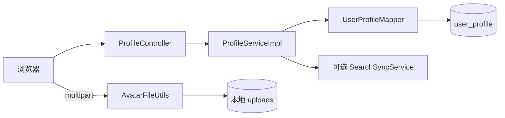

# F02 从 0 做方案：个人资料与头像

> 假设 F01 已能给出可信 `CurrentUserDTO`。现在要解决“用户公开展示什么、本人能修改什么、图片怎样安全保存”。

## 1. 为什么账号和资料要分开

账号负责登录与安全；资料负责昵称、头像、性别、签名、专业、生日等公开展示。混成一张 API 对象最危险的后果是：查询他人主页时可能把密码哈希、邮箱、手机号、角色或状态一起返回。

因此 F02 的核心不是做一个编辑表单，而是建立 **公开信息、私密凭证、资源所有权、文件边界**。

## 2. 从零开始会遇到的问题

1. **公开资料和账号凭证放一张表还是两张表？**  
   **本项目回答：** 拆成 `user_account` 与 `user_profile`。公开查询只映射 `ProfileVO`，避免密码哈希、联系方式、角色和治理状态被误返回。
2. **查看他人资料可以匿名吗？修改时怎样证明是本人？**  
   **本项目回答：** 查看是公开能力；修改路由受拦截器保护，Service 使用当前登录用户 id，而不是客户端声称的 ownerId。
3. **使用 `PUT /profiles/{userId}` 还是 `PUT /profiles/me`？**  
   **本项目回答：** 本项目选择 `/me`，从 API 形状上消除常见水平越权入口；查看别人仍使用路径中的 userId。
4. **新用户没有资料行时返回 404 还是补默认资料？**  
   **本项目回答：** 当前查询会按需创建默认资料，兼容旧账号和演示数据；代价是 GET 有副作用，理想方案是在注册事务中创建资料。
5. **头像存数据库、服务器磁盘还是对象存储？**  
   **本项目回答：** 教学版存本地磁盘、数据库只存 URL。它便于理解完整上传链，但多实例和容灾场景应替换成 OSS/S3。
6. **只检查 `.jpg` 扩展名够不够？**  
   **本项目回答：** 不够。当前同时限制大小、校验 MIME、尝试图片解码/签名，并由服务端生成 UUID 文件名，原始文件名不进入路径。
7. **文件写成功但数据库更新失败怎么办？**  
   **本项目回答：** 普通数据库事务不能回滚文件。目前可能留下孤儿文件，明确列为可忍受的教学版缺陷；生产需临时对象、补偿删除或垃圾回收。
8. **旧头像怎样清理？多实例怎样共享？**  
   **本项目回答：** 当前没有完整旧文件清理，多实例本地盘也不共享。这是迁移对象存储前必须解决的技术债。
9. **资料改变后搜索索引怎样更新？**  
   **本项目回答：** ES 开启时在数据库提交后调用 `SearchSyncService`。这样不污染主事务，但同步失败会陈旧，只能靠重建恢复。
10. **资料统计应在 Controller 查还是独立 Service？**  
    **本项目回答：** 当前统计 Controller 直接使用 JdbcTemplate，功能可用但分层不理想；应下沉 Service/Mapper 以便复用、事务和测试。

## 3. 当前数据和请求设计

- `user_account`：F01 的凭证与状态。
- `user_profile`：以 `user_id` 为主键保存公开资料。
- `GET /api/profiles/{userId}`：公开读，参数表示被查看者。
- `PUT /api/profiles/me`：只改当前登录者，不接收可伪造的 ownerId。
- `POST /api/profiles/me/avatar`：上传本人头像。
- `GET /api/profiles/{userId}/stats`：聚合关注、帖子、精华、获赞等展示统计。

## 4. 技术选择与替代方案

| 功能部分 | 当前选择 | 为什么选 | 没选什么，为什么 |
| --- | --- | --- | --- |
| 资料建模 | 账号/资料分表 + `ProfileVO` | 安全边界清晰，公开查询不会触碰凭证 | 所有字段放 `user_account` 简单但泄露风险和耦合更高 |
| 本人修改路径 | `/me` + 拦截器身份 | URL 中没有可伪造 ownerId | `/profiles/{id}` 仍可安全实现，但每次都要显式比较 id，误漏风险更高 |
| 数据访问 | MyBatis-Plus | 简单主键 CRUD 适合 | JdbcTemplate 更直观但样板多；JPA 对此功能收益不明显 |
| 上传协议 | `multipart/form-data` | HTTP 上传二进制的标准做法 | Base64 JSON 体积更大且占内存；让客户端传本地路径完全不可用 |
| 文件名 | 服务端 `userId + UUID + 受控扩展名` | 防重名和路径注入 | 原始文件名不可信，也可能包含 `../` |
| 图片验证 | 大小 + MIME 白名单 + ImageIO/WEBP 签名 | 不只相信扩展名和请求头 | 只看 Content-Type 可被伪造；只看扩展名更弱 |
| 存储 | 本地文件系统 | 零外部依赖，适合 IDEA 学习 | OSS/S3 更适合生产，但要账号、网络、签名和成本 |
| DTO 校验 | Bean Validation | 长度与空值规则贴近输入 | 仅依赖数据库截断会产生模糊错误 |

## 5. 技术分别解决了哪一段

- `UpdateProfileDTO`：昵称、签名、专业等输入上限。
- `ProfileVO`：只输出允许公开的字段。
- `AuthenticationInterceptor`：为 `/me` 请求提供可信 userId。
- `ProfileServiceImpl.updateOwnProfile`：只按当前用户 id 更新白名单字段。
- `AvatarUploadDTO/MultipartFile`：承载上传内容。
- `AvatarFileUtils.validate`：拒绝空文件、超限和伪图片。
- `AvatarFileUtils.generateFileName`：客户端文件名不进入保存路径。
- `WebMvcConfig.addResourceHandlers`：把 `/uploads/**` 映射到本地目录。
- `SearchSyncService`：启用 ES 时在资料改变后同步公开搜索副本。

## 6. 关键设计判断

### 6.1 为什么是 `/me`

“修改谁”是权限问题，不是普通参数。`/me` 强迫后端从认证上下文取 ownerId，减少水平越权的设计空间。查看接口仍使用 `{userId}`，因为公开查看别人是产品需求。

### 6.2 为什么默认资料按需创建

当前 `getProfile` 在缺少资料行时创建默认行，保证旧账号或演示数据仍可访问。代价是 GET 发生写操作：它不再是严格无副作用的读请求。更整洁的方案是在注册事务中同步创建 `user_profile`，再把缺失视为数据异常。

### 6.3 文件和数据库为什么难以形成一个事务

数据库事务不能回滚普通磁盘写入。当前流程先保存文件再更新资料，数据库失败可能留下孤儿文件。小型本地项目可以接受；生产需临时文件 + 提交后移动、补偿删除、对象存储事件或定期垃圾回收。

## 7. 缺陷台账

| 缺陷/后果 | 状态 | 处理结论 |
| --- | --- | --- |
| 本地文件只存在单台机器 | **当前可接受** | 教学环境简单；多实例前迁移 OSS/S3 或共享存储 |
| GET 缺资料时写数据库 | **设计债务** | 可运行，但应改成注册时建资料；查询只读 |
| 头像更新后旧文件可能残留 | **未解决** | 增加旧路径记录和提交后删除，或定期清理未引用对象 |
| 数据库与文件不在同一事务 | **未完全解决** | 当前规模可忍受；需要补偿/临时文件策略 |
| ImageIO 解码不能防所有图片炸弹/恶意元数据 | **未解决** | 公网需像素上限、重编码、病毒扫描、隔离域名和响应头 |
| `ProfileStatsController` 直接用 JdbcTemplate | **分层缺陷** | 功能简单但 Controller 知道 SQL；应迁入 Service/Mapper 以便测试和复用 |
| `gender` 的 `@Pattern` 当前被注释 | **未解决** | 数据库可能收到任意值；应启用枚举校验并迁移旧数据 |
| ES 同步是提交后尽力调用 | **可恢复但非可靠投递** | 失败会留旧索引；可全量重建，生产可用 Outbox |

## 8. 为什么不直接上 OSS

如果目标是学习“上传请求 → 安全校验 → 文件名 → 保存 → URL 入库”，本地磁盘最透明。OSS 解决的是扩容、可用性和 CDN，不解决文件是否合法；过早接 OSS 会让签名、网络和凭据问题遮住核心链路。

正确演进是先抽象 `FileStorage` 接口，再提供 `LocalFileStorage` 和 `OssFileStorage` 两个实现，而不是让 Service 直接依赖厂商 SDK。

## 9. 面试追问

**问：为什么不能相信 `userId` 路径参数？** 查看别人时它只是查询目标；修改时它会成为越权入口。当前用 `/me` 并从拦截器取得身份。

**问：为什么不把图片存 BLOB？** BLOB 能跟数据库事务一致，但会放大数据库容量、备份和 IO 压力。论坛图片更适合对象存储，表中只保存 URL/对象键。

**问：检查 MIME 后为什么还要解码？** MIME 来自请求头，可伪造；实际解码或魔数检查能进一步确认内容格式，但仍不是完整恶意文件检测。

**问：多实例部署有什么问题？** 用户上传到 A 实例的本地磁盘，B 实例读不到。必须使用共享/对象存储，或确保请求粘滞但后者仍不利于故障迁移。

### 9.1 面试官还能怎样继续追问

**延伸：为什么常用前端直传 OSS？** 后端先鉴权并签发短期、限大小和对象键前缀的预签名 URL，浏览器直传可减少应用服务器带宽；上传完成后仍需回调/确认、内容扫描和对象归属校验。

**延伸：CDN 为什么会继续显示旧头像？** 同一个 URL 可能被浏览器和 CDN 缓存。常见做法是文件名内容寻址或每次换新 UUID，再更新资料 URL，而不是依赖立即 purge。

**延伸：图片炸弹是什么？** 文件字节很小但解码后像素极大，会耗尽内存；只限制上传字节不够，还要限制宽高/总像素、超时解码并最好重编码去除恶意元数据。

**延伸：文件与数据库怎样做补偿？** 可先写临时对象，事务提交后转正；更新失败删除临时对象；再用定时任务扫描“无数据库引用且超过安全时间”的对象，做到最终清理而不是幻想跨资源 ACID。

## 10. 源码与验证

- 主链：`ProfileController → ProfileServiceImpl → UserProfileMapper`。
- 文件：`AvatarFileUtils`、`WebMvcConfig.addResourceHandlers`、`LegacyAvatarController`。
- 表：`user_profile`。
- 测试：`AccountRecoveryApiTest.localAvatarAndPostImageCanBeReadBack`。

## 11. 学习完成检查（先回答，再点击展开）

自测 1：为什么修改资料使用 /me 比 /profiles/{userId} 更不容易越权？

**参考回答：** /me 强制从认证上下文取得资源所有者，不给客户端选择 ownerId；后者也能做安全，但每个入口都必须比较路径 id 与当前用户，漏一次就形成水平越权。

自测 2：怎样在不修改 Controller 契约的前提下从本地磁盘迁移到 OSS？

**参考回答：** 抽象 FileStorage 接口，让 Service 依赖接口；本地和 OSS 各提供实现。Controller 仍接收 MultipartFile/返回 URL，只通过配置切换实现，同时补预签名、补偿删除和 CDN 策略。

自测 3：为什么 MIME 校验通过仍不能说明文件安全？

**参考回答：** Content-Type 可由客户端伪造，普通解码也挡不住图片炸弹、恶意元数据和解析器漏洞；还需魔数/实际解码、像素上限、重编码、病毒扫描、隔离域名与安全响应头。

