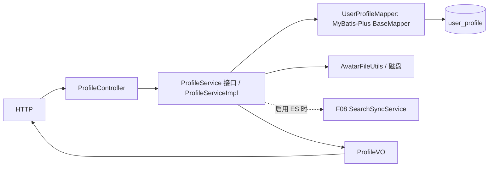

# F02 从代码学个人资料：一次请求经过哪些方法

本文件解释当前 `f02_profile` 的**已实现代码**。建议在 IDEA 里同时打开 `ProfileController`、`ProfileServiceImpl`、`UserProfileMapper` 和 `AvatarFileUtils`，按下列箭头逐个跳转。`GUIDE.md` 是功能清单，这里讲运行流程与边界。

## 1. 数据先认清

`UpdateProfileDTO` 是客户端输入；`CurrentUserDTO` 由 F01 鉴权拦截器生成，不能由前端 JSON 自称；`UserProfileEntity` 对应 `user_profile` 一行；`ProfileVO` 是公开资料响应。资料表以 `user_id` 为主键，更新的是**当前登录用户**的行。头像文件在磁盘上，表中只存 URL，因此文件与数据库不是一个原子事务。

## 2. 三条真实请求链

### GET `/api/profiles/{userId}`：读他人资料

`ProfileController.getProfile` → `ProfileServiceImpl.getProfile` → `UserProfileMapper.selectById(userId)` → `ProfileVO`。若找不到资料，当前实现会调用私有 `createDefaultProfile` 并 `insert` 一行，再返回默认值。注意：该 Service 方法标了 `@Transactional(readOnly=true)`，却可能写表；并且它没有先验证 `user_account` 是否存在。面试时应直说这两个边界，不能声称“任意 userId 都已做存在性检查”。

### PUT `/api/profiles/me`：改自己的资料

`ProfileController.updateOwnProfile` 通过 `@RequestAttribute` 取得可信用户，通过 `@Valid` 接收 `UpdateProfileDTO` → `ProfileServiceImpl.updateOwnProfile` → `selectById`（缺行则 `createDefaultProfile`）→ 覆盖可编辑字段 → `updateById` → 如启用了 F08 则 `SearchSyncService.userChanged` → 返回 `ProfileVO`。字段值含 `null` 时也会覆盖当前资料；调用方需要提交完整可编辑资料，不能假设是 PATCH 的“只改传入字段”。数据库提交后才触发 F08 的索引同步回调，索引失败不会回滚 MySQL。

### POST `/api/profiles/me/avatar`：上传头像

`ProfileController.uploadOwnAvatar` 接收 multipart 文件 → `ProfileServiceImpl.uploadOwnAvatar` 先 `selectById`（缺资料直接 404）→ `AvatarFileUtils.validate` 检查非空、20 MB 上限、允许的 MIME 和 `ImageIO` 可解码 → `generateFileName` 生成按用户目录隔离的随机名 → 创建目录并 `transferTo` → `updateById` 写 `avatarUrl` → 返回 URL 字符串，Controller 包成 `ApiResponse<String>` 并给 HTTP 201。上传流程没有 F08 同步调用。磁盘写入先于数据库提交，失败清理和旧文件回收并不完整。

当前文件保存根目录为 `update/avatars`，返回 URL 使用 `/upload/avatar/`；而 `generateFileName` 已含 `userId/`，Service 拼返回 URL 时又拼了用户 ID。请实际核对静态资源映射与返回 URL：代码目前不能据此证明“上传后 URL 一定可访问”，这也是值得动手修的练习。

## 3. 方法间的职责索引

| 方法 | 谁调用 | 做什么 / 下一步 |
| --- | --- | --- |
| `ProfileController.getProfile/updateOwnProfile/uploadOwnAvatar` | HTTP | 参数绑定、响应码、调用同名 Service 方法；不直接写 SQL |
| `ProfileServiceImpl.getProfile` | Controller | 查资料；缺行走 `createDefaultProfile` |
| `ProfileServiceImpl.updateOwnProfile` | Controller | 写当前用户资料；可选通知 F08 |
| `ProfileServiceImpl.uploadOwnAvatar` | Controller | 校验文件、存磁盘、更新资料 URL |
| `ProfileServiceImpl.createDefaultProfile` | `getProfile/updateOwnProfile` | 构造默认实体，调用 Mapper 插入 |
| `AvatarFileUtils.validate/generateFileName` | 上传 Service | 内容校验、随机文件名；不负责数据库事务 |
| `UserProfileMapper.selectById/insert/updateById` | Service | MyBatis-Plus 提供的主键 SQL 操作 |

## 4. 为什么这样分层、有什么缺口

Controller 只处理 HTTP；Service 管“谁能改”和文件/数据库的执行顺序；Mapper 管资料行。随机文件名避免原始文件名覆盖与路径注入，图片解码检查比只看扩展名强，但 MIME 与真实格式未严格绑定，也没有图片重编码。资料写在 MySQL 是权威数据；ES 若启用，只是搜索副本。

未解决的问题包括：读请求创建资料、并发首次创建的主键冲突、文件与数据库不原子、旧头像累积、返回路径与保存路径不一致。现阶段小数据量可能使磁盘垃圾不明显，却不会使路径错误消失。解决方向是“注册时创建资料或按需无副作用返回默认值”、唯一键冲突后重读、先存临时文件并在事务完成后清理/发布、统一 URL 映射与文件根目录；这些是**改进建议，不是当前已经实现**。

## 5. 自己跟一次与验证

用两个账号 A/B：A 更新显示名，B GET A 的 profile；再用 A 上传一张图片，对比数据库 `avatar_url`、磁盘实际文件和浏览器 GET 返回 URL。调试断点放在 Controller 三个入口、`createDefaultProfile`、`AvatarFileUtils.validate`、Mapper 调用前后。再试不存在的 `userId`、非图片、超大文件和未登录修改，记录实际状态码。对应自动测试可从 `src/test/java` 的功能测试中按 `profile` 搜索；上述路径缺口需要独立验证，不能由“上传接口返回成功”代替。
