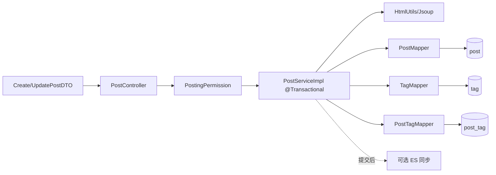

# F03 从 0 做方案：帖子、标签、列表与详情

> 帖子是论坛的核心聚合。它不是简单的一张 `post` 表：还涉及作者权限、富文本、标签多对多、分页、软删除、互动计数、搜索副本和后台状态。

## 1. 为什么要实现这个功能

F01 只解决“谁在使用系统”，F03 才产生论坛主要内容。产品需要创建、编辑、列表、置顶、详情和删除；后续评论、点赞、搜索、首页、通知和治理都依赖帖子 id 与状态。

第一版目标：MySQL/H2 强一致地保存帖子和标签，只有作者能编辑/删除，公开查询只返回可见帖子，富文本经过清洗。

## 2. 从零会遇到的问题

1. **正文存纯文本、Markdown 还是 HTML？**  
   **本项目回答：** 当前保存经过 Jsoup 白名单清洗的 HTML，以支持基本富文本；纯文本更安全但表达弱，Markdown 仍需渲染和二次清洗。
2. **标签存字符串、JSON 还是关系表？**  
   **本项目回答：** 使用 `tag + post_tag` 多对多模型，支持去重、筛选、热门统计和外键关系；逗号字符串写入简单但难以可靠查询。
3. **创建帖子与写标签失败一半怎么办？**  
   **本项目回答：** `PostServiceImpl` 用同一个 Spring 数据库事务包住 post、tag 和 post_tag 操作，任何一步异常都回滚。
4. **如何阻止别人修改帖子？**  
   **本项目回答：** Service 先加载帖子并比较 `author_id` 与当前用户；登录成功只代表有身份，不代表拥有这个资源。
5. **删除采用物理删除还是软删除？**  
   **本项目回答：** 当前改变状态/删除标记，公开查询过滤不可见帖子，保留审计与关联上下文；真正的隐私擦除仍需独立流程。
6. **长度规则在哪里限制？**  
   **本项目回答：** DTO 的 Bean Validation 提前给友好错误，Service 做业务规则，数据库列长度和约束作为最终边界。
7. **富文本怎样防 XSS，图片怎样引用？**  
   **本项目回答：** 服务端用 Jsoup 白名单清洗 HTML；图片先走受控上传接口再保存 URL，不能相信前端已经过滤。
8. **列表怎样分页，深分页怎么办？**  
   **本项目回答：** 当前使用普通分页，适合教学数据；数据量大时 OFFSET 扫描和结果漂移明显，应按 `created_at + id` 改游标分页。
9. **计数列会不会和关系表不一致？**  
   **本项目回答：** F05 在关系变化的同一事务中原子增减计数，降低漂移；仍应准备离线对账修复人工修改或历史异常。
10. **帖子改变后 ES 与首页缓存什么时候更新？**  
    **本项目回答：** ES 是提交后尽力同步，首页默认直接查 SQL、Redis 开启后依靠 TTL/失效策略。数据库事务不能覆盖这两个外部系统。
11. **帖子创建后是 PENDING 还是 PUBLISHED？**  
    **本项目回答：** 当前代码默认 PUBLISHED，所以 F11 虽有审核接口，却没有形成完整“先审后发”主流程；这是必须诚实说明的边界。

## 3. 领域模型

- `post`：作者、分类、标题、正文、摘要、状态、置顶/精华、互动计数、时间。
- `tag`：去重后的标签名称和使用次数。
- `post_tag`：帖子与标签的多对多关系，UNIQUE `(post_id, tag_id)`。

## 4. 技术选型与替代方案

| 功能部分 | 当前选择 | 为什么选 | 同类方案为什么没选 |
| --- | --- | --- | --- |
| 数据真相 | MySQL/H2 关系模型 | 帖子、用户、标签关系和事务很适合关系库 | MongoDB 可嵌套文档，但多对多、治理和事务并未因此更简单 |
| 持久层 | MyBatis-Plus | F03 以实体 CRUD 和条件查询为主 | JPA 学习成本与隐式 SQL更高；JdbcTemplate 会重复映射代码 |
| 标签 | `tag + post_tag` | 标签可复用、统计、索引和按标签查 | 逗号字符串无法可靠去重/查询；JSON 简化写入但关系与统计更难 |
| 内容格式 | 受控 HTML | 现有 WangEditor 直接产生 HTML，展示方便 | 纯文本丢格式；Markdown 更安全可控但要改编辑器和渲染链 |
| XSS | Jsoup 白名单清洗 | 服务端统一处理所有客户端 | 只靠 Vue 转义挡不住富文本 `v-html`；正则不能正确解析 HTML |
| 删除 | 软删除/状态 | 保留引用、审核与审计语义 | 物理删除会破坏评论/通知链接；事件溯源对当前规模过重 |
| 写一致性 | Spring `@Transactional` | 帖子、标签、关联要么一起成功 | 分布式 Saga 没必要；这里只在同一个数据库 |
| 权限 | Service 查作者 + 当前用户 | 资源级规则贴近业务 | 只在前端隐藏按钮无安全性；只在拦截器无法知道具体帖子作者 |
| 分页 | page/size + LIMIT/OFFSET | 页面型列表简单、可跳页 | 游标性能稳定但不易任意跳页；F10 聊天再使用游标 |
| 搜索同步 | 可选 after-commit ES | 回滚不应产生索引文档 | 在数据库事务内调用 ES 会拉长事务，仍不能原子提交两套系统 |

## 5. 真实实现中每项技术负责什么

- `CreatePostDTO/UpdatePostDTO`：标题、正文、分类、标签数量和长度边界。
- `AuthenticationInterceptor`：确认登录身份。
- `PostingPermission`：确认用户没有仍生效的禁言。
- `PostServiceImpl`：作者权限、状态规则、事务编排、Entity/VO 转换。
- `HtmlUtils`：Jsoup 清洗正文、抽取摘要。
- 三个 Mapper：分别写帖子、标签和关联表。
- UNIQUE 与事务：防止重复标签关系和半成品帖子。
- `PostImageController`：本地图片上传；URL 再进入富文本。
- `SearchSyncService`：启用 ES 时在提交后同步帖子。
- `PostApiTest`：覆盖作者编辑/删除、匿名写和他人越权。

## 6. 创建和编辑时的关键决策

### 创建

1. DTO 先做格式校验。
2. 用可信 userId 校验发帖权限。
3. 清洗 HTML，不能保存未经处理的脚本。
4. 插入 `post`，再查/建 tag，最后写 `post_tag`。
5. 所有数据库写入同一事务；任何一步失败整体回滚。
6. 提交后才同步 ES，因为回滚帖子不应被搜索到。

### 编辑

必须先查帖子，再比较 `author_id == currentUser.userId`，并拒绝已删除等不可编辑状态。更新标签时需删除旧关联、调整使用次数、建立新关联；这些动作也要在同一事务。

### 删除

当前采用状态/软删除语义，公开查询统一过滤不可见状态。好处是评论、通知和审计仍能引用帖子；代价是所有查询都不能忘记状态条件。

## 7. 缺陷台账

| 缺陷/后果 | 状态 | 结论 |
| --- | --- | --- |
| OFFSET 深分页越往后越慢 | **当前可接受** | 教学数据小；信息流规模上来后改 keyset/cursor |
| `tag.use_count` 是冗余计数 | **有一致性风险** | 当前与关系变更同事务；仍应提供定期对账修复 |
| 软删除要求每个查询记得过滤 | **已在主要查询处理** | 以后可封装统一条件并加“已删除不可见”回归测试 |
| ES 提交后同步失败会索引陈旧 | **可恢复未完全解决** | 日志 + 全量重建；生产应使用持久 Outbox/MQ |
| 本地图片不适合多实例 | **暂留** | F02 同样问题；生产迁移对象存储 |
| 富文本白名单可能删掉用户想要的样式 | **可接受取舍** | 安全优先；明确允许标签与属性，不能为兼容关闭清洗 |
| 当前新帖默认 `PUBLISHED` | **产品缺口** | F11 有审核接口但未形成默认待审流；若产品要求先审，应改初始状态为 `PENDING` |
| 计数列可能因历史 bug/人工 SQL 漂移 | **未自动修复** | 增加基于关系表的 reconciliation 定时任务 |
| 图片上传与发帖不是一个事务 | **暂留** | 用户上传后放弃发帖会留孤儿图片；需临时对象和定期清理 |

## 8. 为什么不一开始就用 Elasticsearch 存帖子

ES 擅长检索，不擅长作为论坛交易真相：更新一致性、关系约束、事务和精确恢复都不如关系库。正确角色是 MySQL 保存事实，ES 保存可重建搜索投影。即使 ES 全丢，也能从 MySQL 重建。

## 9. 为什么不用 Redis 直接保存计数

Redis 加计数快，但关系和计数会进入最终一致性问题：Redis 成功、数据库失败怎么办，Redis 丢数据怎么办。当前先在 MySQL 同事务维护关系与计数，理解正确性以后再针对真正热点引入 Redis 和回写/对账。

## 10. 面试追问

**问：事务能保证 MySQL 和 ES 一致吗？** 不能。`@Transactional` 只覆盖关系数据库。after-commit 避免回滚时错误建索引，但调用失败仍会陈旧，需要 Outbox/MQ 或重建补偿。

**问：为什么标签不是一个字符串字段？** 多对多表能唯一约束、统计热度、按标签过滤并复用标签；字符串方案写入简单但查询和一致性差。

**问：为什么软删除？** 保留讨论上下文和审计，减少外键级联风险。代价是每个读取必须过滤状态，并考虑隐私删除的真正擦除需求。

**问：怎样防止用户编辑别人帖子？** 登录只证明“是谁”；Service 还要加载帖子并比较 `author_id`。前端隐藏按钮不是权限校验。

### 10.1 面试官还能怎样继续追问

**延伸：`@Transactional` 默认能解决哪些并发问题？** 它保证同一数据库事务的原子提交，不自动防止丢失更新、幻读，也不覆盖 ES/文件系统。编辑冲突可增加 version 条件更新或 ETag。

**延伸：Jsoup 清洗后还需要 CSP 吗？** 需要纵深防御。白名单可能配置错误或遇到浏览器解析差异；CSP、HttpOnly Cookie、输出编码和避免危险 v-html 能降低单点失守的影响。

**延伸：游标分页为什么通常用 `created_at + id`？** 时间可能相同，只用 created_at 会漏项或重复；复合游标提供稳定全序，并需匹配复合索引。

**延伸：标签成为热点行怎么办？** 并发创建同名标签仍靠唯一约束；use_count 若高频原子更新会产生行锁竞争，可改为关系实时统计、异步聚合或分片计数，并用对账恢复。

## 11. 源码与验证

- 主链：`PostController → PostServiceImpl → Post/Tag/PostTagMapper`。
- 安全：`PostingPermission`、`HtmlUtils`、`PostImageController`。
- 表：`post`、`tag`、`post_tag`。
- 测试：`PostApiTest`，跨功能规则另见 `FeatureFlowApiTest`。

## 12. 学习完成检查（先回答，再点击展开）

自测 1：为什么标签要拆成 tag 和 post_tag，而不是一个逗号字符串？

**参考回答：** 关系表能对标签复用、唯一约束、按标签过滤和聚合热门；字符串存在转义、模糊匹配、改名和重复问题。代价是创建帖子要在事务中维护三张表。

自测 2：为什么数据库事务不能保证 Elasticsearch 与帖子一致？

**参考回答：** Spring 本地事务只控制数据库连接，ES 是独立系统；afterCommit 只避免回滚脏索引，提交后调用仍可能失败。当前靠降级和重建，生产可用 Outbox/MQ/CDC 加监控。

自测 3：当前发帖和审核流程的真实状态是什么？

**参考回答：** F03 创建默认 PUBLISHED，因此帖子立即可见；F11 虽有 PENDING 审核接口，但没有成为默认主流程。不能在面试中说项目已经完整实现“先审后发”。

