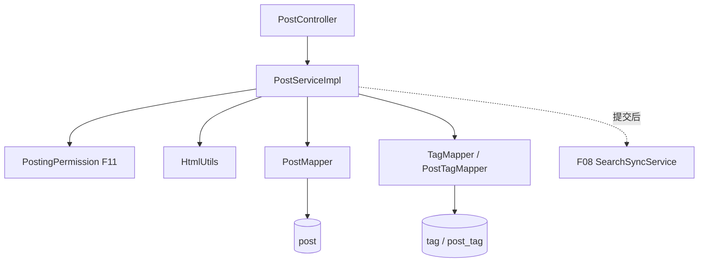

# F03 从代码学帖子：创建、编辑、列表、详情、删除

本文件按当前 `f03_post` 源码讲方法接力。阅读顺序：`PostController` → `PostService` → `PostServiceImpl` → 三个 Mapper、`HtmlUtils` → `schema.sql` 中 `post/tag/post_tag`。

## 1. 输入和数据模型

前端的发帖/编辑 DTO 只承载允许填写的字段，`authorId` 来自 F01 的 `CurrentUserDTO`，不能相信请求体。`PostEntity` 是 `post` 表的一行；标签通过 `tag` 和 `post_tag` 多对多关联；详情和列表分别输出 `PostDetailVO` 与 `PostSummaryVO`。分类是 `post.category` 字符串，`validateCategory` 对照 Service 中固定的 `CATEGORIES` 集合校验；当前没有分类表，且“公告”仅管理员可发。`summary/cover` 从处理后的正文提取，`like_count/comment_count` 等计数由其他功能维护。

## 2. 写入链：理解事务与标签关系

**POST `/api/posts`**：`PostController.createPost` → `PostServiceImpl.createPost` → `PostingPermission.requireCanPost`（F11 禁言）→ `validateCategory` → `sanitizeAndValidateContent`（`HtmlUtils.sanitize`）→ 从正文得 `summary/firstImage` → `PostMapper.insert`，作者、状态与计数由服务端确定 → `replaceTags` → `normalizeTags` → `findOrCreateTag` → `TagMapper` / `PostTagMapper` → 可选 `SearchSyncService.postChanged` → `toDetail` → `loadTagNames` → 201。`findOrCreateTag` 在唯一键并发插入冲突后重读已有标签。整个数据库写链在 Service 事务中。

**PUT `/api/posts/{postId}`**：`updatePost` → `PostingPermission.requireCanPost` → `requireVisiblePost` → `ensureOwnerOrAdmin`（真实作者或管理员）→ 类目和正文校验 → `PostMapper.updateById` → `replaceTags` 计算旧/新标签、更新关联与使用量 → F08 同步通知 → `toDetail/loadTagNames`。编辑不是前端直接提交整个 `PostEntity`，敏感列不会由 JSON 任意覆盖。

**DELETE `/api/posts/{postId}`**：`deletePost` → `requireVisiblePost` → `ensureOwnerOrAdmin` → `currentTagIds`/`decrementTags` → 条件更新为 `DELETED` 且写 `deletedAt` → F08 同步通知 → 204。是软删除，历史行仍在库里；并发状态变化要看条件 UPDATE 的影响行数。F04 评论可见性等后续读取依赖帖子是否 `PUBLISHED`。

## 3. 读链：为什么需要批量组装

**GET `/api/posts`**：`getPosts` → `validatePage` → `visiblePosts` 拼出已发布且未删除约束 → Mapper `COUNT` 和一页 `SELECT` → `applySort` 选择代码允许的排序 → `toSummaries` 批量取 `accountNames` 与各帖 `loadTagNames` → `PageResponse`。分页在 SQL 层完成，不是把全表拿到 Java 切片。大偏移量仍可能慢。

**GET `/api/posts/top`**：`getTopPosts` 只读已发布、置顶帖，按更新时间/id 排序并限制 10 条，再复用 `toSummaries`。**GET `/api/posts/{postId}`**：`getPost` → `requireVisiblePost` → `accountNames/loadTagNames` → `toDetail`。这里详情读取本身不是浏览数递增；F05 有独立浏览接口。

## 4. 方法关系速查

| 方法组 | 调用关系和职责 |
| --- | --- |
| `createPost/updatePost/deletePost` | Controller 同名方法 → Service 写事务 → Mapper；尾部可选 F08 同步 |
| `getPosts/getTopPosts/getPost` | Controller → Service 读方法 → Mapper 查询 → VO |
| `validateCategory` | 创建、编辑前确认分类可用 |
| `sanitizeAndValidateContent` / `HtmlUtils.sanitize/plainText/summary/firstImage` | 清理正文、生成纯文本摘要和首图 |
| `normalizeTags/findOrCreateTag/replaceTags/currentTagIds/decrementTags` | 标签名规范化、查建标签、重算关系与计数 |
| `visiblePosts/applySort/validatePage/requireVisiblePost` | 统一可见性、排序白名单、分页和详情存在性 |
| `ensureOwnerOrAdmin/isAdmin` | 编辑/删除授权；不是只靠页面隐藏按钮 |
| `toSummaries/toDetail/loadTagNames/accountNames/value` | 数据库实体与账号、标签组装成响应 |
| `badRequest/internal` | 构造业务异常，交给全局异常处理器 |

`PostMapper/TagMapper/PostTagMapper` 是 MyBatis-Plus Mapper，和 F04 的 `JdbcTemplate` Mapper 风格不同；接口来自 `BaseMapper` 的 `insert/select/update` 会由框架生成 SQL。

## 5. 在调试器里跑一个具体例子

假设 A 发布标题“期末复习”、分类“学习交流”、标签 `["Java", "#Spring", "java"]`。`normalizeTags` 先去空格、去开头的 `#`、转小写并去重，得到 `[java,spring]`，最多 10 个、单个不超过 20 字符。`findOrCreateTag` 查 `tag.name`，不存在才插；`replaceTags` 写两条 `post_tag`，分别把 `tag.use_count` 加 1。之后 A 编辑为 `[spring,mysql]`：`currentTagIds` 得旧集合 `{java,spring}`，新集合是 `{spring,mysql}`；只删 java 关系并减其次数，只增 mysql 关系并加其次数，spring 不动。数据库事务保证任一步失败时帖子编辑与关系变更一起回滚。

帖子列表 `getPosts` 分两次 SQL：`selectCount(visiblePosts(...))` 得总数，再将 `applySort` 与 `LIMIT size OFFSET (page-1)*size` 加到列表查询。排序允许 `latest`（创建时间）、`active`（更新时间）和 `hot`（点赞、评论、浏览数依次比较）；每种排序最后按 id 打破时间/计数相同的并列。`toSummaries` 收集本页所有 postId 和去重的 authorId；`loadTagNames` 批量查 `post_tag` 和 `tag`，`accountNames` 批量查作者，避免 20 篇帖子逐篇额外查询的 N+1 问题。

## 6. 边界、面试问法与练习

MySQL 中帖子与标签是权威状态；ES 只是可选搜索副本。编辑先提交 MySQL，再尝试同步索引，故索引可能短时间旧；当前同步失败仅记录日志，没有可靠的增量重试队列，应通过重建索引修复。HTML 清理降低脚本注入风险，但图片地址是否可信、富文本展示的前端处理仍需单独核查。计数字段是派生值，并发更新靠 SQL 原子增减及事务，跨功能长期对账机制尚需补充。

练习：从 `PostApiTest` 跑“发帖 → 列表 → 编辑 → 详情 → 删除”；在 `replaceTags` 处观察旧/新集合；用普通用户编辑他人帖子和被禁言用户发帖，记录状态码；删除后再走 F08 搜索及 F04 评论，比较读口径。画出 `post`、`tag`、`post_tag` 三表关系，并解释为何标签不能直接存成一个逗号字符串。
