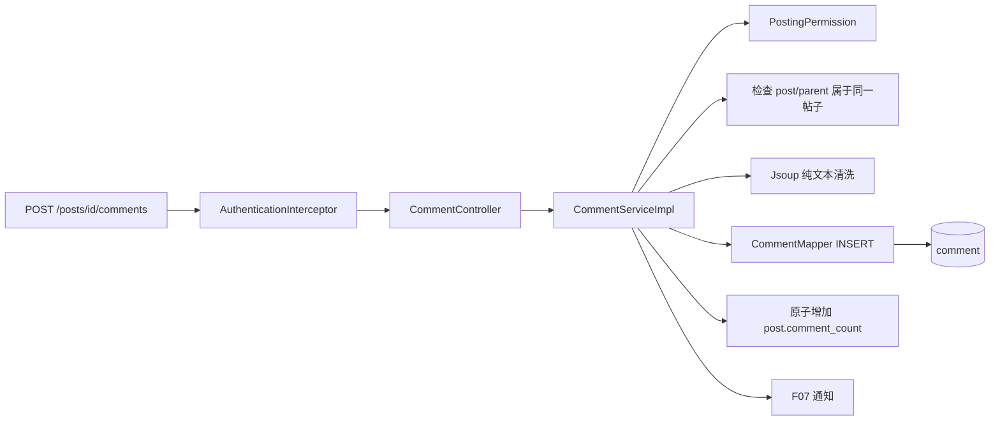

# F04 从 0 做方案：评论与楼中楼回复

> 评论看起来只是“帖子下面加文字”，真正困难是树结构、跨帖子校验、删除语义、查询次数、计数一致性和通知目标。

## 1. 为什么需要评论功能

帖子提供主题，评论形成讨论。产品需要一级评论、回复某条评论、展开楼中楼、删除但保留上下文、图片地址和点赞数。F04 还要为 F05 点赞、F07 通知、F11 禁言提供稳定目标。

## 2. 从零会遇到的问题

1. **回复怎样知道帖子、根楼层、直接父评论和被回复用户？**  
   **本项目回答：** comment 保存 `post_id`、`parent_id`、`root_id`、`reply_user_id`；根评论关系字段为空，子回复统一归到 root 下平铺展示。
2. **能否把 A 帖子的 parentId 带到 B 帖子？**  
   **本项目回答：** 不能。Service 加载父评论后核对它的 `post_id`，不一致直接拒绝，防止跨帖构造错误关系。
3. **无限层树怎样分页？**  
   **本项目回答：** 当前不递归返回任意深树，而是“一级评论分页 + root 下回复平铺”，牺牲树形纯度换查询和页面稳定性。
4. **删除父评论后子回复怎么办？**  
   **本项目回答：** 采用软删除并遮蔽原文，保留占位和子回复上下文，不级联物理删除整棵讨论。
5. **查询 20 条评论会不会产生 N+1？**  
   **本项目回答：** 当前先收集作者和被回复用户 id，再批量查询账号名称并组装 VO，避免在循环里反复调用 Mapper。
6. **评论数何时加减？**  
   **本项目回答：** 评论插入/软删除与 post 的原子计数更新放同一事务；只有状态真正改变时才修改计数。
7. **评论允许 HTML 和任意图片 URL 吗？**  
   **本项目回答：** 文本经 Jsoup 转为安全纯文本；图片目前保存受控 URL 列表，上传能力复用 F02，但仍应限制来源域和对象所有权。
8. **回复通知发给谁？**  
   **本项目回答：** 依据动作目标通知帖子作者或被回复用户，并跳过给自己发通知；`event_key` 用于防止重试产生重复通知。
9. **禁言检查放在哪里？**  
   **本项目回答：** 放在共享 `PostingPermission` Service，由发帖和评论共同调用；Controller 校验容易遗漏，纯 AOP 又会隐藏业务数据判断。
10. **楼中楼用 OFFSET 还是游标？**  
    **本项目回答：** 当前分页足够教学使用；高并发新增下 OFFSET 可能漂移，生产应使用稳定排序字段加 id 的游标。

## 3. 当前模型为什么有三个关系字段

- `parent_id`：本次直接回复哪条评论。
- `root_id`：属于哪个一级楼层，便于一次查询整个楼中楼。
- `reply_user_id`：界面显示“回复 @谁”，避免每次再沿父链推导。

根评论三个字段为空；回复评论的 `root_id` 指向根。这个模型把任意深回复折叠成“一级楼层 + 平铺回复”，符合论坛常见展示。

## 4. 技术选型与替代方案

| 部分 | 当前选择 | 为什么选 | 没选什么，为什么 |
| --- | --- | --- | --- |
| 树结构 | 邻接字段 `parent_id + root_id` | 写入和楼中楼查询简单，支持回复任意评论 | Nested Set 更新代价大；Closure Table 查询强但多一张关系表；递归 CTE 跨 H2/MySQL 教学更复杂 |
| 展示 | 根评论分页 + 每楼少量预览 + 游标展开 | 首屏不会加载完整大树 | 一次返回整棵树会响应巨大；每根评论单独查会 N+1 |
| 数据访问 | JdbcTemplate | SQL、JOIN、批量 IN 和受影响行数对初学者可见 | ORM 也能做，但树装配容易被懒加载/N+1 隐藏 |
| 内容 | Jsoup `Safelist.none()` | 评论以纯文本为产品规则，直接去掉 HTML | 允许富文本会增加白名单、样式和 XSS 面积 |
| 删除 | 软删除 + 占位文字 | 保留子回复的上下文和楼层结构 | 硬删除会让子回复失去父节点；级联删除破坏讨论记录 |
| 图片地址 | JSON 字符串列表 | 不额外建表，适合最多 9 张的小列表 | comment_image 表更规范但多 JOIN；逗号字符串无法安全转义 |
| 作者装配 | 收集 userId 后一次 IN 查询 | 避免逐评论查询用户 | ORM lazy loading 很容易产生 N+1 |
| 事务 | 评论、计数、同步通知同事务 | 主数据库结果一致 | 把计数异步化更快但引入最终一致性和对账 |

## 5. 创建回复时必须按什么顺序

1. `PostingPermission.requireCanPost`：确认账号未被有效禁言。
2. `visiblePost(postId)`：帖子必须存在且公开。
3. 清洗和限制正文；图片最多 9 个，只接受本站路径或 HTTP(S) URL。
4. 有 `parentId` 时加载父评论，确认它属于同一个 `postId` 且未删除。
5. 算出 `rootId/replyUserId`。
6. 插入评论并原子增加帖子评论数。
7. 产生带 `event_key` 的通知：一级评论通知帖子作者，回复通知父评论作者。

顺序不能随便换。例如先插入再检查父评论，会短暂产生非法跨帖数据；计数不在事务中会出现评论成功但计数不加。

## 6. 查询怎样避免 N+1

根评论页不是“查出根评论后循环调用 Mapper”。当前做法：

1. 一条 SQL 查当前页根评论。
2. 一条批量 SQL 查这些 rootId 的回复预览。
3. 收集根评论、回复中的作者和被回复者 id。
4. 一条 `IN (...)` SQL 查全部账号名。
5. 在 Java 内存中按 rootId 分组组装 VO。

查询次数大体固定，不随根评论数量线性增长。

## 7. 缺陷台账

| 缺陷/后果 | 状态 | 结论 |
| --- | --- | --- |
| 冗余 `root_id/reply_user_id` 可能与父链不一致 | **已在写入路径校验** | 所有创建必须走 Service；仍可加 DB 约束/离线校验 |
| 软删除原文仍保存在数据库 | **产品取舍** | 保留审核证据；若涉及隐私删除，应异步脱敏或真正擦除 |
| 图片 URL 允许远程 HTTP(S) | **有风险但服务端不抓取** | 当前只是返回给浏览器，不产生 SSRF；仍可能有隐私跟踪/坏链，应考虑只允许本站上传 |
| 图片列表存 JSON 字符串 | **当前可接受** | 不适合按单张图片检索；需求出现再拆表 |
| comment_count 是冗余值 | **事务内维护** | 能避免正常请求漂移，但人工 SQL/历史 bug 仍需对账任务 |
| 根评论用 OFFSET | **规模内可接受** | 深页变慢；可改 `(created_at,id)` 游标 |
| 删除评论后通知不会撤回 | **暂留** | 通知是历史事件；点击时应处理目标已删除状态 |
| 当前只对作者/管理员开放删除 | **已解决主要权限** | 若需要版主、超时禁止自删等规则，要扩展状态机 |
| 没有数据库外键保证 parent/post 关系 | **依赖 Service** | 教学版便于 H2/MySQL兼容；生产应评估 FK 或一致性检查 |

## 8. 面试追问

**问：为什么不直接递归返回评论树？** 页面通常只展示一级评论和少量回复；完整树可能无限大。根分页 + 回复预览 + 游标展开能控制响应大小。

**问：`root_id` 不是冗余吗？** 是，以写入复杂度换读取效率。没有它时展开一个楼层需要递归查询；有它可直接按 rootId 查，但必须保证写入一致。

**问：软删除有什么问题？** 能保留上下文，但数据仍在库中且所有查询要正确遮蔽原文；隐私合规场景可能需要物理擦除。

**问：怎样发现 N+1？** 打开 SQL 日志，请求一页 20 条评论；如果 SQL 数随评论数增长就是信号。当前作者和回复都批量查询。

### 8.1 面试官还能怎样继续追问

**延伸：N+1 查询有哪些解决方式？** 可用批量 IN、JOIN、DataLoader 或缓存。本项目选择批量账号查询，既把查询次数固定下来，也避免一条多表 JOIN 因一对多关系产生大量重复行。

**延伸：评论树还能怎样建模？** 邻接表写入简单但递归查询贵；materialized path 读子树方便但移动节点更新多；nested set 读树快、插入复杂。本项目的 root 平铺模型更适合论坛楼中楼。

**延伸：热门帖子评论分页为何会漂移？** OFFSET 前面插入新评论后，下一页位置移动，可能重复或漏项；应按固定排序的 created_at/id 使用 keyset cursor。

**延伸：软删除是否满足“删除我的数据”？** 不一定。界面遮蔽不等于不可恢复擦除；隐私要求可能还包括数据库脱敏、搜索副本删除和备份到期清理，需要与审计保留规则平衡。

## 9. 源码与验证

- 主链：`CommentController → CommentServiceImpl → CommentMapper`。
- 跨包：`PostingPermission`、`NotificationService`。
- 表：`comment`、`post.comment_count`。
- 测试：`FeatureFlowApiTest.replyCannotCrossPosts`、`commentPreviewImagesAndSoftDelete`。

## 10. 学习完成检查（先回答，再点击展开）

自测 1：回复评论的四个关键 id 分别解决什么？

**参考回答：** post_id 限定帖子，parent_id 指直接父评论，root_id 把楼中楼归到一级根，reply_user_id 支持展示“回复谁”。创建时必须校验 parent 与 post 一致。

自测 2：为什么批量查作者比循环调用 Mapper 更好？

**参考回答：** 循环查询产生 N+1，网络往返和 SQL 解析随评论数线性增长；先收集去重 id 再一次 IN 查询，查询次数基本固定，再在内存映射。

自测 3：父评论软删除后为什么不级联删除回复？

**参考回答：** 回复可能包含独立讨论，级联删除会破坏上下文并扩大误删；当前遮蔽父评论原文、保留占位和子回复。若涉及隐私擦除，需要另行清除敏感内容。

