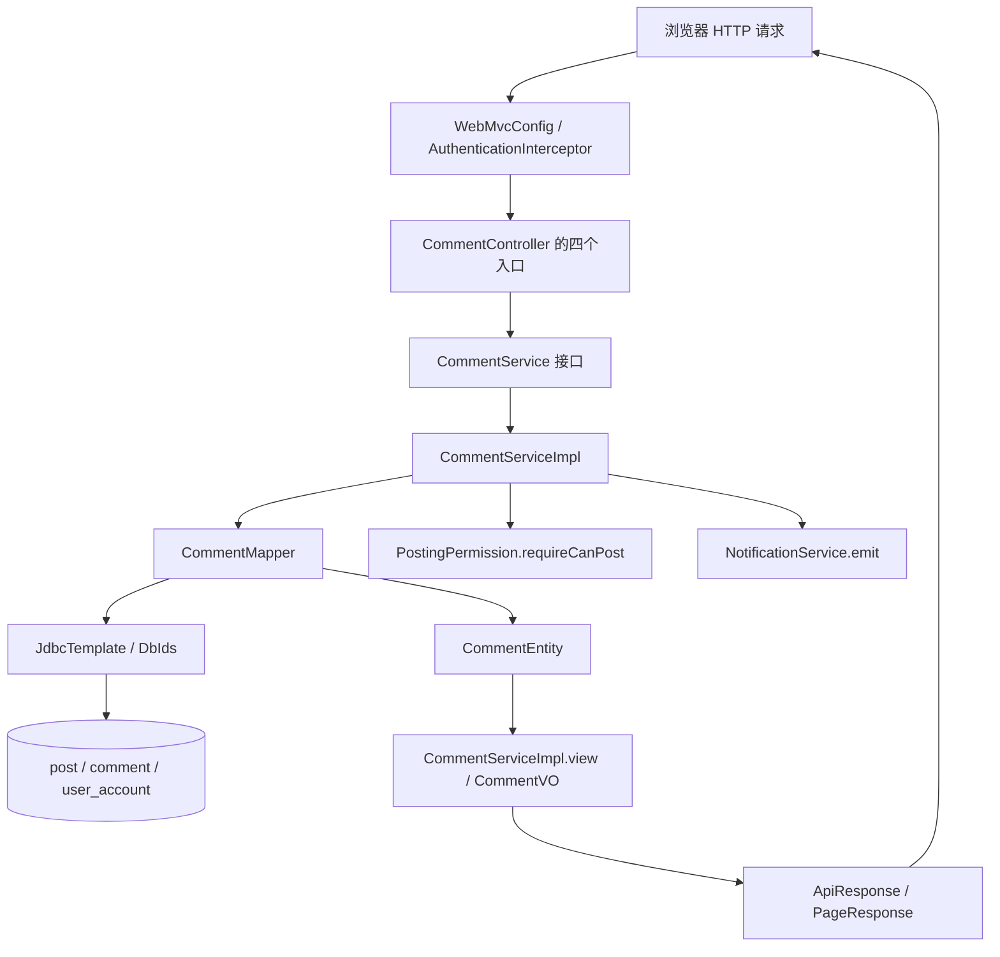

# F04 从代码学评论：每个方法怎样接力

这份笔记只讲当前 `f04_comment` 包里**已经写出的实现**。打开 IDEA 时，把本文件和 `CommentController`、`CommentServiceImpl`、`CommentMapper` 并排看。`GUIDE.md` 是功能清单；这里按一次请求真正执行的顺序读代码。

## 1. 先弄懂这几个对象

浏览器发来的 JSON 先变成 `CreateCommentDTO`；查询参数由 Controller 放进 `CommentPageDTO`。数据库 `comment` 的一行被 `CommentMapper.map` 转成 `CommentEntity`。Service 再把它转成 `CommentVO`，Controller 用 `ApiResponse` 包起来返回。`PageResponse<CommentVO>` 只用于根评论分页。DTO/Entity/VO 都是 Java `record`：例如 `input.parentId()` 读输入，`row.rootId()` 读数据库值。

| 数据 | 从哪里来 | 用来做什么 |
| --- | --- | --- |
| `postId` | URL `/api/posts/{postId}/comments` | 确定评论属于哪篇帖子 |
| `user.userId()` / `user.role()` | F01 鉴权拦截器写入的 `CurrentUserDTO` | 确定真实作者和删除权限 |
| `input.content()` / `input.parentId()` / `input.imageUrls()` | POST 请求体 | 正文、直接父评论、图片地址 |
| `parent_id` | `comment` 表 | 这条回复直接回复哪条评论；根评论为 `NULL` |
| `root_id` | `comment` 表 | 这条回复属于哪棵根评论树；根评论为 `NULL` |
| `reply_user_id` | Service 从父评论的 `author_id` 推算 | 回复指向谁；客户端不能指定 |

例子：A 的根评论 id=10；B 回复 A，产生 id=11、`parent_id=10`、`root_id=10`、`reply_user_id=A`；C 回复 B，产生 id=12、`parent_id=11`、`root_id=10`、`reply_user_id=B`。因此 11 和 12 都会在根评论 10 的楼中楼列表。**存储上允许继续回复某条回复；展示时按 `root_id` 收进同一楼。**

`schema.sql` 中的 `comment` 表还保存 `image_urls` JSON 字符串、`like_count`、`deleted`、`created_at`、`deleted_at`。帖子表中的 `comment_count` 是评论总计数，创建和删除时由本包同步更新。

## 2. 一张图看清层与调用方向



`CommentService` 是接口，只规定 `create/roots/replies/delete` 的参数和返回类型；运行时 Spring 注入带 `@Service` 的 `CommentServiceImpl`。`CommentMapper` 带 `@Repository`，用 `JdbcTemplate` 执行 SQL；**F04 不是 MyBatis Mapper 接口**。Controller 不直接执行 SQL，Mapper 也不决定作者是否有权删除。

`WebMvcConfig.addInterceptors` 把 `/api/posts/**` 与 `/api/comments/**` 交给 F01 拦截器。`AuthenticationInterceptor.preHandle` 放行本包两个 GET；POST/DELETE 必须有有效 Bearer Token，然后把可信 `CurrentUserDTO` 放到 request attribute。Controller 用 `@RequestAttribute` 取它。业务错误通过 `CommentServiceImpl.error` 生成 `BusinessException`，最后由 `GlobalExceptionHandler` 转成带 `code/message` 的 JSON；鉴权错误由拦截器自己写响应。

## 3. POST：创建根评论或回复

从 [CommentController.create](controller/CommentController.java) 开始：`@PathVariable` 取 `postId`，`@RequestBody` 把 JSON 变为 `CreateCommentDTO`，`@RequestAttribute` 取可信用户。它只调用 `service.create(postId, user, request)`，成功后返回 HTTP 201 和 `ApiResponse<CommentVO>`。

```text
CommentController.create
  → CommentServiceImpl.create              [一个写事务]
    → PostingPermission.requireCanPost     [禁言检查；到期时可触发 F11 解禁]
    → CommentMapper.visiblePost            [帖子必须 PUBLISHED 且未删除]
    → Jsoup.clean + 正文/图片校验
    → 有 parentId 时 CommentMapper.find     [父评论必须存在、同帖、未删除]
    → CommentServiceImpl.writeImages        [图片列表转 JSON 字符串]
    → CommentMapper.insert → DbIds.insert   [INSERT comment，取生成的 id]
    → CommentMapper.incrementPostCount      [UPDATE post.comment_count + 1]
    → 根评论：CommentMapper.postAuthor       [查帖子作者]
      回复：直接用父评论 authorId
    → NotificationService.emit              [通知对象由上一步确定]
    → CommentMapper.find                    [重读刚插入的评论]
    → CommentServiceImpl.namesFor           [批量查名字]
      → CommentMapper.accountNames
    → CommentServiceImpl.view               [Entity → VO]
      → CommentServiceImpl.readImages       [JSON → 图片列表]
  → ApiResponse.success                     [201 响应]
```

逐步读 [CommentServiceImpl.create](service/impl/CommentServiceImpl.java)：

1. `PostingPermission.requireCanPost(user.userId())` 查用户是否禁言；这是 F11 的共用规则，不是 F04 自己查询处罚表。
2. `mapper.visiblePost(postId)` 用 `SELECT COUNT(*) ... status='PUBLISHED' AND deleted_at IS NULL` 判断帖子可评论。不存在或不可见，抛 `POST_NOT_FOUND`（404）。
3. `Jsoup.clean(..., Safelist.none()).trim()` 清理 HTML 后检查正文为 1～2000 字符。`imageUrls` 默认空列表；最多 9 个，每个须是有 host、长度不超过 1024 的 HTTPS URL。这里**只验证 URL，没有上传图片，也没有验证图片实际可访问**。
4. `parentId == null` 时，`rootId/replyUserId` 都为 `null`，创建根评论。否则 `mapper.find(parentId)` 取父评论，检查父评论 `postId` 与 URL 相等且未删除；`rootId` 取父评论自己的 id 或它的 `rootId`，`replyUserId` 取父评论作者。输入里没有 `replyUserId` 字段。
5. `writeImages(images)` 调用 Jackson 序列化成 JSON；`mapper.insert` 把七个业务值和当前时间绑定到 SQL 的 `?` 上。`DbIds.insert` 用 `GeneratedKeyHolder` 拿数据库生成的评论 id。
6. `mapper.incrementPostCount` 使用 `comment_count=comment_count+1`，并再次要求帖子仍然可见。受影响行数不是 1 就抛 `POST_CHANGED`（409），事务回滚，刚插入的评论也不会留下。
7. 根评论通过 `mapper.postAuthor` 通知帖子作者，回复则通知直接父评论的作者。`notifications.emit` 在默认同步配置下写通知；F07 会过滤自己通知自己，并用事件键 `COMMENT:<评论id>` 防重复。启用 RabbitMQ 时 F07 改为同事务写 outbox。
8. 重新 `find(id)` 得到含数据库默认值的 `CommentEntity`；`namesFor` 收集作者 id，通过 `accountNames` 查询账号名；`view` 生成 `CommentVO`。这一步返回的 `replies` 是空列表，完整楼中楼由查询接口组装。

`@Transactional` 包住本方法的数据库写入。这里的事务边界由 Spring 在 Controller 调用 Service 代理时建立，Mapper 自身没有事务注解。业务异常会触发回滚。

可以在 IDEA 中用 `parentId=null` 与 `parentId=一条回复的 id` 各单步执行一次，重点观察 `rootId` 和通知接收人的变化。

## 4. GET：一页根评论和每楼三条预览

[CommentController.roots](controller/CommentController.java) 接收 `page`（默认 1）、`size`（默认 20）、`sort`（默认 `hot`），创建 `CommentPageDTO` 后调用 `service.roots`。这是匿名可读接口；返回 `ApiResponse<PageResponse<CommentVO>>`，其中 `total` 表示根评论数量。

```text
CommentController.roots
  → CommentServiceImpl.roots               [只读事务]
    → CommentMapper.visiblePost
    → 校验 page/size/sort
    → CommentMapper.countRoots              [本帖根评论总数]
    → CommentMapper.roots                   [本帖当前页根评论]
    → CommentMapper.previewReplies          [当前页所有根楼，各取最新 3 条]
    → CommentServiceImpl.namesFor
      → CommentMapper.accountNames          [所有作者/被回复用户名一次取回]
    → 对每条预览 CommentServiceImpl.view
    → 对每条根评论 view → withReplies         [组装嵌套 VO]
    → PageResponse(items,total,page,size)
  → ApiResponse.success
```

`roots` 先验证帖子，再要求 `page>=1`、`1<=size<=100`，排序只允许 `hot/asc/desc`。`countRoots` 的 SQL 用 `post_id=? AND parent_id IS NULL`，只数根评论。`mapper.roots` 也用这两个条件，另加 `LIMIT/OFFSET`：`asc` 为创建时间和 id 升序，`desc` 为二者降序，`hot` 为点赞数和 id 降序。第二个排序字段让同值时顺序稳定。`sort` 只从固定三种 SQL 片段中选，用户字符串不直接进入 SQL。

`previewReplies` 收集**这一页**根评论 id，在一条 SQL 里使用 `root_id IN (...)`；`ROW_NUMBER() OVER (PARTITION BY root_id ORDER BY id DESC)` 对每楼分别编号，只留 `rn<=3`。`namesFor` 再批量查所有作者和被回复人的 `account`。最后 `view` 把行变 VO，`withReplies` 创建新的根 VO 并放入预览回复。若该页无根评论，`previewReplies` 和 `accountNames` 都直接返回空结果。这样不会为每条根评论分别查一次回复和用户名。

例如第 2 页、每页 20 条，Mapper 的 `OFFSET` 是 `(2-1)*20=20`。`PageResponse.total` 仍来自 `countRoots`，不是当前页 `items.size()`。

## 5. GET：展开楼中楼，按游标取更早回复

[CommentController.replies](controller/CommentController.java) 从 URL 取 `parentId`，`beforeId` 默认 `Long.MAX_VALUE`，`size` 默认 20。匿名可读，返回 `ApiResponse<List<CommentVO>>`，**这里没有 `PageResponse` 和总数**。

```text
CommentController.replies
  → CommentServiceImpl.replies              [只读事务]
    → CommentMapper.find(parentId)
    → CommentMapper.visiblePost(parent.postId)
    → 校验 size 1～100
    → 从 parent 算 rootId
    → CommentMapper.replies(rootId,size,beforeId)
    → namesFor → CommentMapper.accountNames
    → 每行 view → List<CommentVO>
```

这里的 `parentId` 可以传根评论 id，也可以传楼内回复 id；Service 先把它归到 `rootId`，实际 SQL `WHERE root_id=? AND id<? ORDER BY id DESC LIMIT ?` 读取的是**整棵楼**，不是“只看这个直接父评论的孩子”。第一次不传 `beforeId`，之后把上一批最后一条的 id 传给下一次请求，即可取更早的回复。不存在的评论返回 `COMMENT_NOT_FOUND`（404）；帖子不可见返回 `POST_NOT_FOUND`（404）。

## 6. DELETE：软删除和计数

[CommentController.delete](controller/CommentController.java) 从 URL 取评论 id、从拦截器取当前用户，调用 `service.delete`；成功时 Controller 的 `@ResponseStatus(NO_CONTENT)` 返回 HTTP 204，无响应体。

```text
CommentController.delete
  → CommentServiceImpl.delete               [一个写事务]
    → CommentMapper.find(id)
    → 比对 authorId 与当前 userId，或检查 role 为 ADMIN/SUPER_ADMIN
    → 根评论：CommentMapper.markDeletedTree [根节点和 root_id 指向它的回复一起软删]
    → 子回复：CommentMapper.markDeleted     [只软删这一条]
    → 按实际删除行数：CommentMapper.decrementPostCount
  → HTTP 204
```

`find` 找不到时是 `COMMENT_NOT_FOUND`（404）；既不是作者也不是管理员/超级管理员时是 `COMMENT_FORBIDDEN`（403）。更新 SQL 都带 `deleted=FALSE`，第二次删除更新 0 行，因此重复删除不会再次扣计数。

**删除不执行 SQL DELETE，但公开查询也不会再返回已删除行。** `countRoots/roots/replies/previewReplies` 都过滤 `deleted=FALSE`。删除根评论时若只隐藏根节点，回复会变成没有展示入口的“孤儿”，帖子计数也会和页面不一致，所以当前实现把整棵回复树一起软删除，并按实际行数扣减 `comment_count`；删除一条子回复则只影响它自己。

## 7. 方法总索引：从一个方法快速找到下一个

| 方法 | 谁调用它 | 它调用谁或产生什么 |
| --- | --- | --- |
| `CommentController(CommentService)` | Spring 注入 | 保存 Service 依赖 |
| `CommentController.create` | POST 请求 | `CommentService.create` → `ApiResponse.success`，HTTP 201 |
| `CommentController.roots` | 根评论 GET | `new CommentPageDTO` → `CommentService.roots` |
| `CommentController.replies` | 楼中楼 GET | `CommentService.replies` |
| `CommentController.delete` | DELETE 请求 | `CommentService.delete`，HTTP 204 |
| `CommentServiceImpl(...)` | Spring 注入 | 保存 Mapper、Clock、PostingPermission、NotificationService、ObjectMapper |
| `CommentServiceImpl.create` | Controller 经接口调用 | 权限、校验、`find/insert/incrementPostCount/postAuthor`、通知、`writeImages/namesFor/view` |
| `CommentServiceImpl.roots` | Controller 经接口调用 | `visiblePost/countRoots/roots/previewReplies/namesFor/view/withReplies` |
| `CommentServiceImpl.replies` | Controller 经接口调用 | `find/visiblePost/replies/namesFor/view` |
| `CommentServiceImpl.delete` | Controller 经接口调用 | `find/markDeletedTree 或 markDeleted/decrementPostCount` |
| `CommentServiceImpl.view` | create/roots/replies | `readImages`（未删除时）；构造单个 `CommentVO` |
| `CommentServiceImpl.namesFor` | create/roots/replies | 去重作者及被回复用户 id → `mapper.accountNames` |
| `CommentServiceImpl.withReplies` | roots | 复制根 `CommentVO` 并附加预览列表 |
| `CommentServiceImpl.writeImages` | create | `ObjectMapper.writeValueAsString`，供 `insert` 使用 |
| `CommentServiceImpl.readImages` | view | `ObjectMapper.readValue`，供 VO 使用；空值返回空列表 |
| `CommentServiceImpl.error` | create/roots/replies/delete | 构造 `BusinessException`；无数据库操作 |
| `CommentMapper(JdbcTemplate)` | Spring 注入 | 保存 JDBC 依赖 |
| `CommentMapper.visiblePost` | create/roots/replies | `SELECT COUNT(*)` 查可见帖子 |
| `CommentMapper.postAuthor` | create 根评论分支 | `SELECT author_id`，确定通知接收人 |
| `CommentMapper.find` | create 回复分支、create 插入后、replies、delete | `SELECT *`，每行经 `map` 转 `CommentEntity` |
| `CommentMapper.insert` | create | `DbIds.insert` 写评论并返回新 id |
| `CommentMapper.incrementPostCount` | create | 条件 `UPDATE post` 加一，返回受影响行数 |
| `CommentMapper.decrementPostCount` | delete 且删除成功 | 条件 `UPDATE post` 减一 |
| `CommentMapper.markDeleted` | delete | 条件 `UPDATE comment`，返回受影响行数 |
| `CommentMapper.markDeletedTree` | 删除根评论 | 软删除根节点及其全部回复，返回实际行数 |
| `CommentMapper.countRoots` | roots | `COUNT(*)` 根评论数 |
| `CommentMapper.roots` | roots | 按排序和页码查根评论，每行经 `map` |
| `CommentMapper.replies` | replies | 按 `root_id` 和 `beforeId` 查一批回复，每行经 `map` |
| `CommentMapper.previewReplies` | roots | 用窗口函数批量查每楼三条，每行经 `map` |
| `CommentMapper.accountNames` | namesFor | `SELECT id,account ... IN (...)`，返回 id→账号名 |
| `CommentMapper.map` | `find/roots/replies/previewReplies` 的 `JdbcTemplate.query` | `ResultSet` 一行 → `CommentEntity` |

`CommentService` 接口中的四个同名方法就是 Controller 与 Impl 的连接点，不额外执行逻辑。`CreateCommentDTO`、`CommentPageDTO`、`CommentEntity`、`CommentVO` 是数据载体，没有自己发起调用。

## 8. 对照实际测试与边界

`src/test/java/org/example/rebuiltzijingforum/FeatureFlowApiTest.java` 中，`commentsInteractionsFollowSearchAndHome` 覆盖无 Token 创建返回 401、成功创建、匿名查列表、非作者删除返回 403；`replyCannotCrossPosts` 覆盖跨帖回复返回 `PARENT_INVALID`；`commentPreviewImagesAndSoftDelete` 覆盖非法图片 URL、回复预览、用户名，以及删除根评论后公开列表为空、整棵树已软删、帖子计数归零。这是走 MockMvc → 拦截器 → Controller → Service → Mapper → H2 的测试。

读代码时还要注意当前实现的准确口径：

- `countRoots/roots/previewReplies/replies` 使用同一个 `deleted=FALSE` 可见性口径；若将来需要“删除占位但保留回复”，必须重新设计根评论 total、回复入口和计数语义，不能只删掉这个过滤条件。
- `GET /replies` 的 `beforeId` 是 `id` 游标，不是时间戳；返回按 id 降序。根评论页的 `hot/asc/desc` 是另一套排序逻辑。
- `parentId` 指向已删除父评论时不能新建回复；根评论删除时已有子回复也会一起软删。
- 图片目前只是 HTTPS URL 字符串，`image_urls` 存 JSON；并无本地文件上传功能。

建议亲手跟一次调用：给帖子发根评论 → 回复它 → 回复这条回复 → GET 根评论页 → GET 楼中楼 → 删除根评论 → 再 GET。每一步在 `CommentServiceImpl` 停下，记下 `parentId/rootId/replyUserId`、`post.comment_count` 和最终 `CommentVO`，就能把方法间关系串起来。
