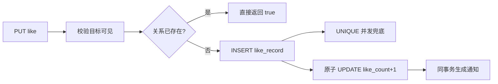

# F05 从 0 做方案：点赞、收藏与浏览计数

> 互动功能最容易在面试中被追问“重复点击怎么办、并发怎么办、关系和计数为什么不会不一致、为什么不上 Redis”。

## 1. 为什么要实现

点赞表达轻量认可，收藏保存个人清单，浏览量反映热度。这三者界面相似，但数据语义不同：点赞/收藏是“用户与目标的关系”，浏览量当前只是“请求次数”。

## 2. 从零会遇到的问题

1. **重复点击或网络重试会不会加两次？**  
   **本项目回答：** PUT 表示“确保已点赞”，DELETE 表示“确保未点赞”；重复请求返回同一最终状态，不采用容易翻转两次的 toggle。
2. **两个并发请求都先查到没点赞怎么办？**  
   **本项目回答：** `like_record` 的组合 UNIQUE 是最终防线。只有一个 INSERT 成功，冲突请求确认关系已存在后按幂等成功处理。
3. **关系表能 COUNT，为什么 post 还存 `like_count`？**  
   **本项目回答：** 列表读取频繁，冗余计数避免每行做聚合；代价是写入必须同步维护，并准备对账。
4. **关系插入成功但计数失败怎么办？**  
   **本项目回答：** 两步在同一个数据库事务中；计数更新失败会回滚关系，正常路径不会留下半成功。
5. **取消不存在的点赞怎样响应？**  
   **本项目回答：** DELETE 保持幂等，关系本来不存在也返回未点赞，不把网络重试变成错误。
6. **帖子和评论两类目标怎样避免动态表名注入？**  
   **本项目回答：** 目标类型只允许后端枚举并映射到固定 SQL 分支，不把客户端传入的表名直接拼进 SQL。
7. **浏览量是 PV 还是 UV？**  
   **本项目回答：** 当前每次调用加一，明确是 PV；刷新、机器人也可能计入。UV 需要登录身份、设备标识或 HyperLogLog 等去重设计。
8. **为什么不用 Redis 直接做主计数？**  
   **本项目回答：** 当前优先保证关系与计数的 MySQL 强一致。Redis 会新增丢失、回写、双写失败和对账问题，规模没有证明值得承担。
9. **需要分布式锁吗？UNIQUE 与锁分别做什么？**  
   **本项目回答：** UNIQUE 表达永远不能违反的数据不变量；锁只能减少竞争，而且会超时或不可用。当前可选 Redis 锁不是正确性的唯一依赖。
10. **点赞通知怎样避免重复？**  
    **本项目回答：** 只有关系真正从无到有时才发事件，并使用稳定 `event_key` 去重；重放时通知表/消费者仍需幂等。

## 3. 先确定接口语义

- `PUT .../like`：确保最终为“已点赞”，重复 PUT 结果相同。
- `DELETE .../like`：确保最终为“未点赞”，重复 DELETE 结果相同。
- 收藏使用相同语义。
- `POST .../view`：每调用一次增加一次 PV；匿名请求允许。

用 PUT/DELETE 表达目标状态，比“toggle”更适合重试。toggle 收到两次会从未赞变已赞再变未赞，客户端不知道最终状态。

## 4. 技术选型与替代方案

| 部分 | 当前选择 | 为什么选 | 没选什么，为什么 |
| --- | --- | --- | --- |
| 点赞真相 | `like_record` 关系表 | 能查询“谁赞了什么”，UNIQUE 可保证幂等 | 只存计数不知道个人状态，也无法撤销和审计 |
| 收藏真相 | `favorite` 关系表 | 收藏是个人关系，不是单纯计数 | 浏览器 LocalStorage 会丢且不能跨设备 |
| 幂等接口 | PUT/DELETE + 唯一键 | 网络重试可安全执行 | POST toggle 不是幂等，重复请求结果翻转 |
| 并发正确性 | 数据库 UNIQUE | 最接近数据、原子、即使应用多实例也有效 | 只在 Java `synchronized` 只能锁单 JVM；Redis 锁不应替代最终约束 |
| 计数展示 | 主表冗余计数 + SQL 原子加减 | 列表读取快，不必每行 COUNT | 每次实时 COUNT 强一致但列表代价高；异步计数会短暂不一致 |
| 事务 | 关系、计数、同步通知同事务 | 防止只改一半 | 分布式事务过重；全部核心事实都在同一数据库 |
| 数据访问 | JdbcTemplate | 受影响行数和原子 SQL 清晰 | ORM 的 save/delete 可能隐藏并发细节 |
| 浏览量 | `view_count=view_count+1` PV | 第一版最简单，写入原子 | UV 需要用户/cookie/IP 去重和隐私策略；HyperLogLog 是近似值 |

## 5. 哪项技术解决哪部分

- `LikeMapper/FavoriteMapper`：关系存在、插入、删除。
- UNIQUE `(user_id,target_type,target_id)` 与 `(user_id,post_id)`：并发重复最终防线。
- `InteractionMapper.changeLikeCount`：数据库内 `count=count+delta`，避免 Java 读改写丢更新。
- `@Transactional`：关系与冗余计数一起提交/回滚。
- `DataIntegrityViolationException` 捕获：并发重复若已由另一请求完成，则把它当作幂等成功。
- target type 白名单：只允许 `POST/COMMENT`，避免任意表名 SQL 注入。
- `NotificationService.emit`：首次成功建立关系时才通知。
- `RedisLockUtils`：仅是可选进阶短锁，当前点赞正确性不依赖 Redis。

## 6. 为什么唯一约束仍不够

唯一约束只能阻止重复关系，不能自动维护 `post.like_count`。因此插入关系与计数加一必须在同一事务。捕获唯一冲突后也不能再次加计数，否则会出现一条关系、两个计数。

取消时以 `DELETE` 的受影响行数为准：删到 1 行才减计数，删到 0 行说明原本就未点赞。

## 7. 为什么当前不用 Redis 做主链

Redis 方案会新增这些问题：

- Redis 成功、MySQL 失败时以谁为准？
- Redis 宕机或淘汰后，关系和计数怎样恢复？
- 定时回写重复执行怎样保证不多加？
- 用户马上刷新，读 Redis 还是 MySQL？
- 通知何时产生，如何避免重复？

当前规模先选 MySQL 强一致，性能不够且经过测量后再引入 Redis。Redis 可以缓存状态或承接热点计数，但关系表仍应是事实源并提供对账。

## 8. 缺陷台账

| 缺陷/后果 | 状态 | 结论 |
| --- | --- | --- |
| 冗余计数可能漂移 | **正常请求已缓解** | 同事务原子更新；仍需定期按关系表对账 |
| 点赞先查再插多一次 SQL | **可接受** | 提供快速幂等返回；UNIQUE 仍兜并发，可优化成数据库原生 upsert |
| 高并发热点行会争抢计数行锁 | **当前可接受** | 未有压测证据；热点出现后再分片/Redis 聚合 |
| PV 可被刷新和机器人放大 | **明确的产品口径** | 当前就是 PV，不伪称 UV；以后可登录用户去重或 HyperLogLog 近似 UV |
| 匿名浏览端点可被刷 | **未解决** | 公网需限流、机器人识别和批量/异步计数 |
| 取消点赞不撤回历史通知 | **可接受** | 通知代表发生过的事件；产品若要求撤回需定义新规则 |
| RedisLockUtils 没有续租/可重入 | **可选工具边界** | 只用于短操作，不能称为完整 Redisson 锁 |
| 评论/帖子计数都存在 int 上限 | **当前可接受** | 规模很小；大规模应使用 BIGINT 并做溢出保护 |

## 9. 面试追问

**问：为什么不用 Redis 分布式锁防重复？** 数据库唯一约束才是最终数据不变量，Redis 可能不可用或锁过期。锁可减轻竞争，但不能替代 UNIQUE。

**问：为什么 `synchronized` 不行？** 它只能保护一个 JVM；部署两个应用实例后各有一把锁。数据库约束对所有实例共同生效。

**问：如何保证关系和计数一致？** 在同一数据库事务中，只有关系 INSERT/DELETE 真正改变时才原子加减计数。再加离线对账应对人工修改和历史缺陷。

**问：PV 与 UV 区别？** PV 是访问次数，刷新也加；UV 是独立访客数，需要身份或近似去重。当前实现是 PV。

### 9.1 面试官还能怎样继续追问

**延伸：接口幂等与消息去重有什么区别？** 接口幂等保证同一意图重试后的资源状态不变；消息去重保证事件重复投递不重复产生副作用。两者都需要稳定业务键，不能只靠“短时间内内容相同”。

**延伸：Redis 分布式锁有哪些常见坑？** 锁过期时业务可能仍未完成，错误删除别人的锁，主从切换可能丢锁。至少要唯一 token + Lua 比较删除，并理解 Redisson 看门狗也不能替代数据库约束。

**延伸：Redis 计数怎样落库？** 可写 Redis 后异步批量落库，但要处理消息丢失、重复消费、Redis 宕机和重放；必须设计幂等日志、定期对账以及以哪一侧为准。

**延伸：热点帖子会造成什么问题？** 单行数据库计数更新会锁竞争，单个 Redis key 也可能成为 hot key。可分片计数、批量聚合、削峰并接受短暂最终一致。

## 10. 源码与验证

- 主链：`InteractionController → InteractionServiceImpl → Like/Favorite/InteractionMapper`。
- DDL：`like_record`、`favorite` 和 `post/comment` 计数列。
- 可选锁：`RedisLockUtils`，默认 Redis 关闭。
- 测试：`FeatureFlowApiTest.commentsInteractionsFollowSearchAndHome`。

## 11. 学习完成检查（先回答，再点击展开）

自测 1：先查、UNIQUE、事务、原子计数分别负责什么？

**参考回答：** 先查优化正常路径和提示；UNIQUE 兜住并发重复；事务绑定关系与计数；原子加减避免并发读改写丢失更新。四者不能互相完全替代。

自测 2：为什么点赞接口不设计成 toggle？

**参考回答：** 请求超时重试时 toggle 两次会回到原状态，客户端无法判断；PUT/DELETE 表达目标状态，重复执行结果相同，天然更适合幂等重试。

自测 3：如果面试官要求改成 Redis 点赞，你先追问什么？

**参考回答：** 先确认吞吐量、可接受一致性、Redis 是否能丢、落库时限和故障恢复目标；再设计关系真相、写路径、幂等事件、回写与对账，而不是只回答 SET/INCR。

