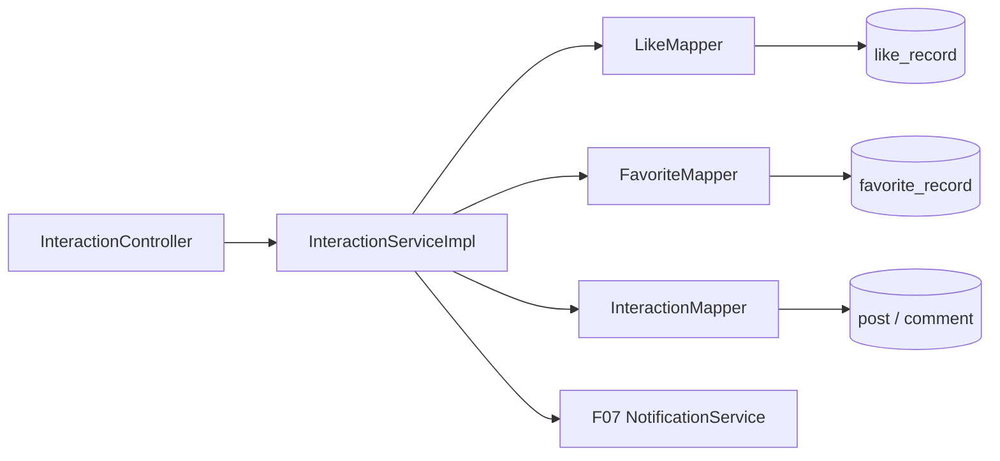

# F05 从代码学点赞、收藏和浏览：关系与计数如何同时变化

读源码时按 `InteractionController` → `InteractionServiceImpl` → `LikeMapper/FavoriteMapper/InteractionMapper` → `schema.sql`。本包当前用 MySQL 保存真实关系和计数，`RedisLockUtils` 虽放在本包，但点赞/收藏方法并未调用它；F09 可选首页缓存才使用该锁。

## 1. 先认表和请求

`like_record` 记录“哪个用户赞了哪个帖子/评论”，`favorite_record` 记录“哪个用户收藏了哪个帖子”。`post.like_count`、`comment.like_count`、`post.favorite_count` 是为了快速展示而冗余保存的计数。业务判断应以关系行为准：有关系就是已赞/已收藏；只有真正新增/删除关系时才改计数。`PostInteractionVO` 把计数与当前登录用户的布尔状态合起来。

## 2. 点赞/取消：一步一步走

`PUT` 帖子或评论点赞入口 → Controller 构造 `InteractionDTO(type,id)` → `InteractionServiceImpl.like(userId,target)` → `validateTarget` → `InteractionMapper.postExists/commentExists`（评论还要关联可见帖且未删除）→ `LikeMapper.find`；已有关系直接返回，不重复加计数。无关系时 `LikeMapper.insert` → `InteractionMapper.changeLikeCount(+1)` → 查目标作者 → `NotificationService.emit`。这些 MySQL 写入由 Service 事务保护；并发相同点赞靠关系唯一约束，遇到重复插入时重查已有关系。

`DELETE` 取消点赞 → `unlike` → 校验目标 → `LikeMapper.delete`。删除影响 1 行才调用 `changeLikeCount(-1)`；本来就没赞则不减。帖子与评论共用同一服务入口，但 Mapper 的表名选择是代码分支，不由客户端把任意表名传入 SQL。通知由 F07 处理自己给自己点赞的过滤和事件去重；取消后再次点赞未必再产生一条通知，因为事件键可能相同，不能把“每次点赞都有通知”当作当前契约。

## 3. 收藏、浏览和状态

`PUT/DELETE` 收藏 → `favorite/unfavorite` → 先由私有 `requirePost` 调 `InteractionMapper.postExists` → `FavoriteMapper.find/insert/delete` → 仅关系实际变化时 `changeFavoriteCount` → 新收藏可 `NotificationService.emit`。同一个用户重复调用 PUT/DELETE，最终关系不变；并发由数据库唯一键兜底。

`POST` 浏览 → `view` → `InteractionMapper.recordView` 执行 SQL `view_count=view_count+1`；更新不到可见帖就返回不存在。当前按接口调用次数计 PV，**没有去重、反刷或按用户统计 UV**。`GET` 帖子互动状态 → `postState` → `postExists` → 查计数、`LikeMapper.find`、`FavoriteMapper.find` → 返回 VO；只通过 URL 确认帖子还不够，用户布尔态必须用 F01 的可信用户 ID。

例如原来帖子 `like_count=2`，用户 A 第一次 PUT：`like_record` 多一行，SQL `like_count=like_count+1` 后为 3；A 再 PUT 不新增关系，仍为 3；A DELETE 删除一行后减回 2；再 DELETE 仍为 2。这里不能写成“先在 Java 读出 2，再保存 3”，并发请求可能互相覆盖。若关系 INSERT 成功、计数 UPDATE 失败，Service 的数据库事务使两者一起回滚；F07 默认同步通知也随之回滚。

## 4. 方法表

| 方法 | 上游 → 下游 |
| --- | --- |
| `InteractionController` 的 8 个入口 | 帖赞/取消、评赞/取消、收藏/取消、浏览、状态；绑定 URL/可信用户并调用 Service |
| `like/unlike` | `validateTarget` → `LikeMapper` → `changeLikeCount`；新赞可发 F07 通知 |
| `favorite/unfavorite` | `requirePost` → `FavoriteMapper` → `changeFavoriteCount`；新收藏可通知 |
| `view/postState` | 原子浏览数更新；关系与计数查询后组装状态 |
| `validateTarget` | 分派 `postExists` 或 `commentExists`，拒绝不可见目标 |
| `LikeMapper.find/insert/delete` | 查询或更改点赞关系，唯一键防重 |
| `FavoriteMapper.find/insert/delete` | 查询或更改收藏关系，唯一键防重 |
| `requirePost` | 收藏和帖子状态共用的可见帖校验，内部调用 `postExists` |
| `InteractionMapper.postExists/commentExists/author/changeLikeCount/changeFavoriteCount/recordView/counts` | 校验目标、查作者、更新或读取派生计数 |

## 5. 技术取舍与真实边界

为什么先用 MySQL？关系、计数、通知的默认同步写可放进同一数据库事务，便于理解和回滚；当前数据规模还没有证明热点帖让数据库计数更新成为瓶颈。改用 Redis 集合/计数可降低热门帖写压，但必须处理 Redis 故障、刷回 MySQL、重复消费和对账；现有代码**没有实现 Redis 点赞主存**，不能在面试中这样说。浏览 PV 可以容忍重复，点赞关系不能。热点行锁竞争、计数与关系长期漂移、恶意刷 PV 是进一步压测/对账要验证的点。

自己验证：同一用户对同一帖连续 PUT 两次、DELETE 两次，分别查 `like_record` 与 `post.like_count`；换一个用户点赞评论，核对 `comment.like_count` 和 F07 通知；并发重复点赞时检查唯一键是否保持一条关系。浏览 3 次后解释为什么 PV 加 3 但不等于 3 个独立访客。
