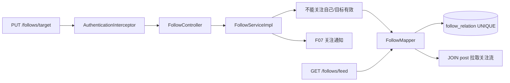

# F06 从 0 做方案：关注、粉丝与关注流

> 关注功能的重点不是一条 INSERT，而是把关系方向说清、保证幂等、选择计数方式，并决定 Feed 用推模式还是拉模式。

## 1. 为什么要实现

关注让用户建立长期兴趣关系；粉丝/关注列表用于社交展示；关注流把已关注作者的帖子聚合到一个页面。它还会产生 F07 关注通知。

## 2. 从零会遇到的问题

1. **`follower_id` 与 `followed_id` 谁指向谁？**  
   **本项目回答：** 一行表示 follower 主动关注 followed；所有关注数、粉丝数和 Feed SQL 都按这条方向定义。
2. **能否关注自己、不存在或被封禁用户？**  
   **本项目回答：** Service 拒绝自关注并校验目标账号存在和状态；不能只依赖前端不展示按钮。
3. **重复与并发关注怎样幂等？**  
   **本项目回答：** PUT/DELETE 表达目标状态，组合 UNIQUE `(follower_id,followed_id)` 兜住并发，重复取关稳定成功。
4. **粉丝数实时 COUNT 还是冗余字段？**  
   **本项目回答：** 当前实时 COUNT，数据量小且不会计数漂移；只有慢查询证明确有瓶颈后才引入冗余计数和对账。
5. **取关不存在关系怎么响应？**  
   **本项目回答：** 按幂等 DELETE 处理，最终“未关注”即成功，方便客户端安全重试。
6. **关注列表是否公开，私密账号怎么办？**  
   **本项目回答：** 当前按公开论坛处理，没有私密账号、关注审批和可见性 ACL，这属于产品暂留。
7. **Feed 读时 JOIN 还是写时推送？**  
   **本项目回答：** 当前采用拉模式，查询时 JOIN `follow_relation` 与 post；写入简单、关系变化立即生效，适合小规模。
8. **大 V 有百万粉丝时推模式会怎样？**  
   **本项目回答：** 会产生写扩散、巨大队列和热点收件箱，所以未来应对普通用户推、大 V 拉，采用混合 Feed。
9. **Feed 怎样分页，取关后历史是否保留？**  
   **本项目回答：** 当前从现有关注关系实时生成，因此取关后内容消失；普通分页在大数据下应演进为时间/id 游标。
10. **关注通知怎样防重复？**  
    **本项目回答：** 只有新关系实际插入后才产生通知，并由事件键再次幂等；仅“接口被调用”不能作为发通知条件。

## 3. 先把方向写死

一行 `follow_relation(follower_id, followed_id)` 表示：左边主动关注右边。

```text
Alice 关注 Bob：follower_id=Alice，followed_id=Bob
Alice 的关注数：WHERE follower_id=Alice
Bob 的粉丝数：WHERE followed_id=Bob
Alice 的 Feed：JOIN post.author_id = followed_id
```

这几个命名不能随意交换，否则列表和计数会悄悄反过来。

## 4. 当前调用方案



## 5. 技术选型与替代方案

| 部分 | 当前选择 | 为什么选 | 没选什么，为什么 |
| --- | --- | --- | --- |
| 关系模型 | 一张有向关系表 | 简单、可反向查询、UNIQUE 易表达 | 用户表存关注 id 数组难更新/查询；图数据库对当前规模过重 |
| 幂等 | PUT/DELETE + UNIQUE | 重试安全，多实例共同有效 | toggle 非幂等；Java 锁不能跨实例 |
| 计数 | 对关系表实时 COUNT | 永远以关系事实为准，不会冗余漂移 | 用户表冗余 following/follower_count 读快，但写和修复更复杂 |
| Feed | 拉模式 `follow JOIN post` | 实现简单、取关立即生效、适合小规模 | 推模式读快但发帖要写 N 个收件箱，大 V 写扩散严重 |
| 数据访问 | JdbcTemplate | JOIN 方向、过滤和分页 SQL 清晰 | ORM 多对多封装可能掩盖查询方向和 N+1 |
| 分页 | OFFSET | 支持普通页码，适合当前 UI | 游标更稳但接口/UI 更复杂，数据量上来后再换 |
| 通知 | 关系首次创建时同步 emit | 与关注事务一致且 event key 幂等 | 先发 MQ 再写关系会产生幽灵通知 |

## 6. 为什么选拉模式 Feed

当前用户量和帖子量没有大规模压测证据。拉模式每次打开 Feed 运行 JOIN，容易实现和纠错：关注关系变化立即体现在结果中，也不需要维护每个用户的时间线表。

推模式适合大量读、关注数可控的场景：作者发帖时把 postId 推到粉丝收件箱。但大 V 会产生写扩散，取关、删帖、补发和失败重试都要处理。真正的大系统常用普通用户推、大 V 拉的混合模式。

## 7. 技术具体负责哪一部分

- UNIQUE `(follower_id,followed_id)`：并发重复关注最终防线。
- Service 自关注检查：给明确 400，而不是等数据库产生奇怪关系。
- `activeUser`：不允许关注不存在或已封禁目标。
- `DataIntegrityViolationException`：并发冲突若关系已存在，就按幂等成功返回。
- 实时 COUNT：按钮旁粉丝数来自关系表，不读取可能过期的浏览器缓存。
- Feed JOIN：只包含当前仍关注作者且状态为 `PUBLISHED`、未删除的帖子。
- `NotificationService.emit`：首次关注才产生一条带 event key 的通知。

## 8. 缺陷台账

| 缺陷/后果 | 状态 | 结论 |
| --- | --- | --- |
| 实时 COUNT 在大用户上会变慢 | **当前可接受** | 先加索引；规模上来后冗余计数并定期对账 |
| 拉模式关注多人后 JOIN 变重 | **当前可接受** | 无大规模证据；可升级游标、缓存或混合 Feed |
| OFFSET 深分页不稳定且慢 | **暂留** | 改成 `(created_at,id)` 游标更适合信息流 |
| 没有私密账号/关注审批 | **产品未实现** | 当前所有关系立即生效；若增加需引入 PENDING/ACCEPTED 状态 |
| 没有拉黑关系 | **未解决** | 私信、资料、关注都需要共同的 block 规则，不能只在 F06 局部补 |
| 没有数据库 CHECK 阻止自关注 | **Service 已阻止，DB 未兜底** | 可增加 `follower_id <> followed_id` CHECK |
| 取关后旧关注通知仍存在 | **可接受** | 通知是历史事件，不代表当前关系；页面应按实时 status 展示 |
| 删除账号可能留下关系 | **取决于外键/注销策略** | 当前未做自助注销；未来需 FK cascade 或明确清理事务 |

## 9. 面试追问

**问：为什么不用 Redis Set 保存关注？** 关系是长期业务事实，需要事务、持久化和复杂 JOIN。Redis 可做缓存，不应在没有恢复/对账方案时成为唯一真相。

**问：推模式和拉模式怎么选？** 拉模式写简单读较重，推模式读快写扩散。当前小型论坛选拉；大规模可按作者粉丝量做混合。

**问：为什么粉丝数不用字段直接加减？** 实时 COUNT 简单且不会漂移；当前规模足够。若性能测量证明慢，再用事务内冗余计数 + 对账。

**问：并发关注怎样处理？** 先查改善普通路径，数据库组合 UNIQUE 兜住并发；冲突后确认关系存在并作为幂等成功。

### 9.1 面试官还能怎样继续追问

**延伸：推 Feed、拉 Feed、混合 Feed 怎样选？** 推模式读快但写扩散，拉模式写轻但读时合并重；混合方案对普通作者推送、对大 V 拉取，再按时间归并。

**延伸：大 V 问题除了写扩散还有什么？** 还包括粉丝列表深分页、关注计数热点、缓存大 key 和通知风暴；常见做法是游标、分片计数、限速和异步队列。

**延伸：共同关注怎样查？** 小规模可 self join/INTERSECT 关系表并建组合索引；高规模社交图可能需要倒排集合或图存储，但先要证明关系查询确实成为瓶颈。

**延伸：Feed 游标为什么不能只用时间？** 多篇帖子可能同一时间，单字段边界不稳定；应使用时间 + postId 复合游标并保持确定排序。

## 10. 源码与验证

- 主链：`FollowController → FollowServiceImpl → FollowMapper`。
- 表：`follow_relation`。
- Feed：`FollowMapper.feed/feedCount`。
- 测试：`FeatureFlowApiTest.commentsInteractionsFollowSearchAndHome`。

## 11. 学习完成检查（先回答，再点击展开）

<details>
<summary>自测 1：Alice 关注 Bob 后，表里两个 id 怎样写，Alice 的 Feed 怎样查？</summary>

**参考回答：** follower_id=Alice、followed_id=Bob；查询 Alice 的关系行，再用 followed_id 关联 post.author_id，并过滤可见帖子后排序分页。
</details>

<details>
<summary>自测 2：为什么当前选择实时 COUNT 而不是粉丝数字段？</summary>

**参考回答：** 当前规模下索引 COUNT 足够，关系表就是真相且不会漂移；冗余字段会让关注/取关增加事务维护和对账成本，应由性能数据驱动引入。
</details>

<details>
<summary>自测 3：百万粉丝作者为什么不适合纯推 Feed？</summary>

**参考回答：** 一次发帖要写百万收件箱，造成写扩散、队列积压和热点；可对大 V 保留拉取，普通作者推送，读取时合并两路结果。
</details>
