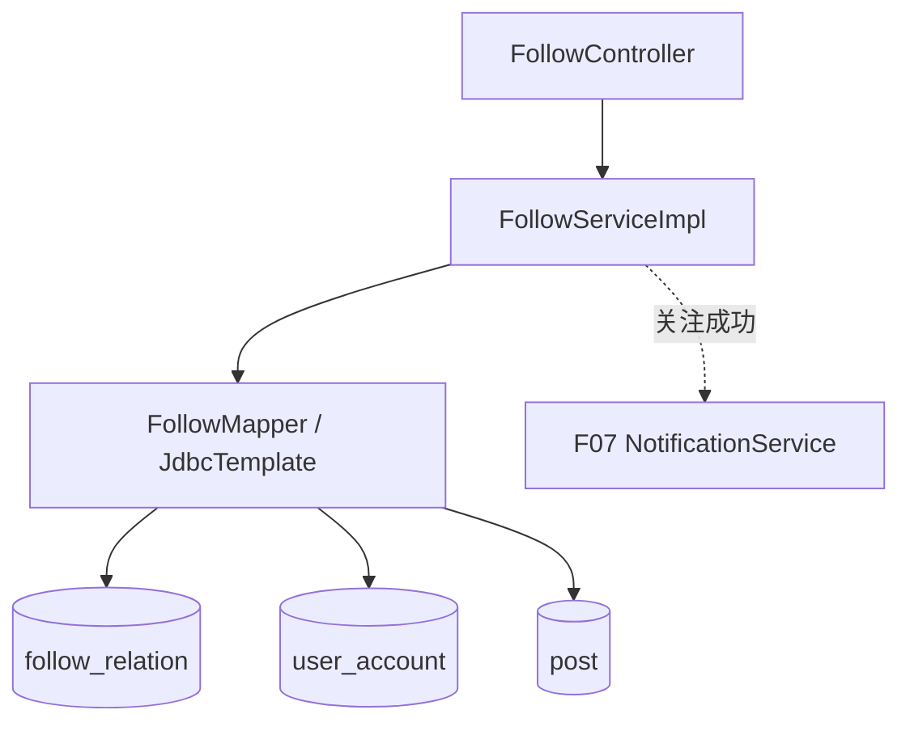

# F06 从代码学关注、粉丝与关注流

按 `FollowController` → `FollowServiceImpl` → `FollowMapper` 阅读。这里的关注流是**查询时拉取**，没有把新帖子推送到每个粉丝的收件箱。

## 1. 先把方向画对

`follow_relation.follower_id` 是发起关注的人，`followed_id` 是被关注的人。A 关注 B 就有 `(A,B)` 一行；A 的“关注列表”查 `follower_id=A`，B 的“粉丝列表”查 `followed_id=B`。唯一约束防同一关系重复。列表 VO 给前端账号信息，关系表仍是关注状态的真值。

## 2. 写请求的完整链

`PUT /api/follows/{targetId}` → `FollowController.follow` 取得 F01 注入的用户 ID → `FollowServiceImpl.follow`：拒绝关注自己 → `requireUser(targetId)` 用 `FollowMapper.activeUser` 检查用户存在且未封禁 → `FollowMapper.follows` 检查是否已关注 → 新关系调用 `add` → F07 `NotificationService.emit` 通知对方 → `followerCount` 返回状态。重复关注返回已关注；并发插入还要由唯一键挡住，Service 捕获冲突后重读。关系和默认同步通知处于写事务中。

`DELETE /api/follows/{targetId}` → `unfollow` → `requireUser` → `FollowMapper.remove` → `followerCount`。删除不存在的关系不会生成负计数，因为粉丝数通过 SQL COUNT 现算，不存冗余计数字段。注意目标被封禁后 `requireUser` 可能让取关也失败；这是当前实现的边界，不能假设总能取消。

## 3. 读请求的完整链

`GET /api/follows/{targetId}/status` → `status` → `requireUser` → `follows` + `followerCount`。`GET /api/follows/users/{userId}/following` 与 `/followers` → 对应 Service → `requireUser` → 私有 `page` 校验（size 1～100）→ Mapper 的分页 JOIN 与 COUNT → `PageResponse`。这些列表公开读取，但关注/取关需要登录。

`GET /api/follows/feed` → `feed(currentUser,page,size)` → `page` → `FollowMapper.feed`：`follow_relation` JOIN `post`，取当前用户关注对象的已发布帖子 → `feedCount` → 分页响应。每次请求按关系表实时拉取，所以新关注者不用补写历史收件箱；关注多、帖子多时 JOIN 与深分页会变慢。目前没有消息队列扇出或预计算时间线。

举例：A 关注 B、C 后，SQL 从 `follow_relation` 取 `(A,B)` 与 `(A,C)`，再找 `post.author_id IN (B,C)` 且帖子可见的行。B 新发帖无需额外往 A 的表里写一份，A 下次查询就能看到；A 取关 B 后，下次查询自动不再包含 B 的帖子。这个行为来自 JOIN 当前关系，不来自 RabbitMQ 推送。

## 4. 方法索引

| 方法 | 调用逻辑 |
| --- | --- |
| `FollowController.follow/unfollow/status/following/followers/feed` | 路由、参数与可信用户传递；返回 `ApiResponse` |
| `FollowServiceImpl.follow/unfollow/status` | 关系增删查、目标校验、粉丝数；成功关注发 F07 |
| `FollowServiceImpl.following/followers/feed` | 调用私有 `page`，再查 Mapper 页面和总数 |
| `requireUser/page` | 公共目标存在性、分页输入规则 |
| `FollowMapper.activeUser/follows/add/remove` | 用户与关系判断、关系写入 |
| `followingCount/followerCount/following/followers` | 两个方向的计数和 JOIN 列表 |
| `feed/feedCount` | 查询当前用户关注人的可见帖子及总数 |

## 5. 为什么选拉模式、还欠什么

当前拉模式用一张关系表和 SQL JOIN 就能跑通，写关注和写帖都简单，数据量小更容易保持实时性。与推模式相比，读放大和深分页是代价；大 V 有海量粉丝时推模式反过来有写放大。没有压测结果就不应声称拉模式已能支撑某个具体用户量。`follow_relation` 的唯一键保证最终只有一条关系，通知却可能因重复关注/重新关注的事件键策略而不按每次操作产生；以代码中的事件键为准。

练习：让 A 关注 B、B 发帖、A 查 feed；再让 C 关注 B，比较 A/C 的 feed。用 SQL 检查 `(follower_id, followed_id)` 的方向；对同一目标重复 PUT、DELETE；用被封禁目标试取关，解释实际返回。若想扩容，先量化 `feed` 的 P95、JOIN 扫描行数和分页偏移，再决定索引或改为游标/混合推拉。
