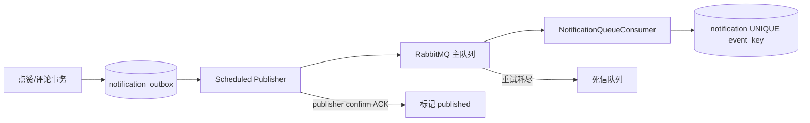

# F07 从 0 做方案：通知中心、缓存与可靠消息

> 通知功能的难点不是“插一行”，而是业务事务与消息系统之间的缝隙、重复投递、用户隔离、未读数缓存和失败恢复。

## 1. 为什么要实现

用户不会一直盯着每个帖子。点赞、收藏、评论、回复、关注和私信发生后，需要告诉内容接收者。通知是业务事件的用户可见投影，不是点赞/评论本身的事实源。

产品能力：未读数、分类列表、单条已读、全部已读；生成通知默认同步写 MySQL，可选升级为 Outbox + RabbitMQ；Redis 只缓存未读数。

## 2. 从零会遇到的问题

1. **自己点赞或回复自己要不要通知？**  
   **本项目回答：** 当前跳过 actor 与 recipient 相同的事件，避免无意义自通知。
2. **网络重试或 MQ 重投会不会生成重复通知？**  
   **本项目回答：** 每个业务事件生成稳定 `event_key`，通知表按它幂等；Rabbit 消费者重放不会再插第二条。
3. **猜 notificationId 能否把别人通知标已读？**  
   **本项目回答：** 所有读取和更新 SQL 同时约束 `notification_id + 当前 user_id`，权限下沉到查询条件。
4. **未读数用 COUNT、计数列还是 Redis？**  
   **本项目回答：** MySQL 通知行是真相并能 COUNT 重建；Redis 开启后只缓存未读快照，丢失或异常就回源。
5. **数据库提交成功但 MQ 发送失败怎么办？**  
   **本项目回答：** 可选异步模式先在同一事务写 Outbox，定时发布器稍后重试，不要求业务请求同时跨库和 MQ 原子提交。
6. **MQ 收到消息但 Outbox 未标已发送就崩溃怎么办？**  
   **本项目回答：** 发布器会再次发送，所以系统接受 at-least-once；下游依靠 `event_key` 幂等吸收重复。
7. **消费者失败重试怎样防止副作用重复？**  
   **本项目回答：** 消费逻辑先做持久化幂等，再 ACK；超过重试进入 DLQ，不能仅靠 broker 的 ACK 声称 exactly-once。
8. **当前有严格顺序或 exactly-once 吗？**  
   **本项目回答：** 没有，也不需要全局顺序。当前目标是至少一次投递 + 幂等结果；同一对象若要求顺序需分区键和版本检查。
9. **Redis 缓存为什么提交后失效？**  
   **本项目回答：** 事务提交前删除可能被并发请求用旧数据库值重新填回；`afterCommit` 缩小脏缓存窗口，Redis 失败不影响 MySQL 真相。
10. **通知表增长和死信怎样处理？**  
    **本项目回答：** 当前尚无归档周期、DLQ 告警和人工重放后台，属于生产化缺口；必须先监控再制定保留与补偿流程。

## 3. 第一版先选同步 MySQL

默认 `forum.rabbit.enabled=false`：点赞/评论等业务 Service 在自己的数据库事务内调用 `emit`，通知直接写 `notification`。好处是容易理解且核心结果强一致；缺点是调用方耦合通知写入，通知故障会让业务回滚。

先做同步版是刻意的：如果连 `event_key`、用户隔离和事务边界都没想清楚，上 MQ 只会把问题藏得更深。

## 4. 可选 RabbitMQ 方案

业务事务不直接发 MQ，而是写 Outbox。定时发布器读未发布行，等 publisher confirm 后再标记成功。消费者调用与同步版相同的 `persistEvent`，数据库 UNIQUE `event_key` 保证重投幂等。

## 5. 技术选型与替代方案

| 部分 | 当前选择 | 为什么选 | 没选什么，为什么 |
| --- | --- | --- | --- |
| 通知事实 | MySQL `notification` | 要分页、已读、持久化、按用户隔离 | 只放 Redis 会因淘汰/故障丢历史 |
| 去重 | 业务 `event_key` + UNIQUE | 跨同步/MQ重投都有效 | 只靠消息 id 不稳定；内存 Set 重启丢失 |
| 默认生成 | 同事务同步写库 | 第一版强一致、零外部依赖 | 直接异步简单但会遇到 DB/MQ 双写丢失 |
| 可靠异步 | Transactional Outbox | 本地事务能原子写业务和待发事件 | XA/2PC 运维和性能成本高；直接 `RabbitTemplate` 无法原子覆盖数据库 |
| 消息中间件 | RabbitMQ Direct Exchange | 路由、确认、重试、DLQ 适合业务事件 | Kafka 更适合高吞吐日志流；当前量级和消费模型没必要 |
| 未读加速 | Redis Cache Aside + TTL | 缓存可丢、MySQL 可重建 | Redis 原子计数速度快但修复、重复事件和已读操作更复杂 |
| 缓存失效 | 事务提交后删除 | 防止未提交旧数据被重新填回缓存 | 事务内先删存在“回源旧 DB 再缓存”的竞态 |
| 用户隔离 | 所有 SQL 带 `user_id` | notificationId 本身不是授权证明 | 先 select 再无条件 update 多一次 SQL 且可能忘记校验 |

## 6. 每项技术具体解决什么

- `NotificationServiceImpl.emit`：过滤自己通知，选择同步或 Outbox 路径。
- `event_key`：例如一次点赞关系对应稳定业务键，重复事件得到同一键。
- `notification(event_key UNIQUE)`：消费者幂等最终防线。
- `notification_outbox(event_key UNIQUE)`：生产阶段也不重复入待发箱。
- `NotificationOutboxPublisher`：轮询、publisher confirm、成功标记、失败保留。
- `RabbitMqConfig`：持久主队列、死信交换机/队列和 routing key。
- `NotificationQueueConsumer`：消费后复用 `persistEvent`。
- `NotificationUnreadCache`：`notification:unread:{userId}`，60 秒 TTL。
- `afterCommit evict`：新通知和已读提交后删除缓存。
- Mapper 的 `WHERE id=? AND user_id=?`：阻止水平越权。

## 7. 为什么不是 exactly-once

发布器可能收到 Rabbit ACK 后，在标记 Outbox 之前崩溃；重启会再次发送。所以交付语义仍可能是 at-least-once。消费者用 `event_key` 幂等，才让最终通知行接近“效果一次”。

这不等于所有副作用 exactly-once：如果消费者在通知入库后还发邮件，邮件也要有自己的幂等键。

## 8. 缺陷台账

| 缺陷/后果 | 状态 | 结论 |
| --- | --- | --- |
| RabbitMQ/Redis 默认关闭且未真实联调 | **未验证** | 只能说代码存在；启用前必须做宕机、重投和恢复测试 |
| 默认同步路径耦合调用方 | **可接受第一版** | 简单强一致；流量/可用性需要时开启可靠异步 |
| Outbox 轮询会有延迟和数据库扫描 | **可接受** | 有 pending 索引；规模大可 CDC 或专用事件服务 |
| ACK 后标记前崩溃会重复发送 | **已用幂等解决效果** | 不宣传 exactly-once |
| 不保证全局严格顺序 | **明确不保证** | 当前事件互相独立；若某聚合要求顺序，要按聚合键分区/版本校验 |
| DLQ 没有管理界面、告警和自动重放 | **未解决** | 生产必须监控并提供人工检查/重放流程 |
| Redis 未读缓存仍可能短暂陈旧 | **已限制** | 提交后删 + 60 秒 TTL + 失败回源，允许短暂展示延迟 |
| 通知表没有归档/保留策略 | **未解决** | 数据增长后按时间归档或删除，保留产品规则需先确定 |
| page/size OFFSET 深页慢 | **暂留** | 通知更适合 id/created_at 游标，可后续升级 |

## 9. 面试追问

**问：为什么 `@Transactional` 不能保证数据库和 RabbitMQ？** Spring 本地事务只控制当前数据源连接，RabbitMQ 是另一个系统。Outbox 把“要发送”先变成同库记录，再异步可靠投递。

**问：publisher confirm 有了还要消费者幂等吗？** 要。confirm 只证明 broker 收到；ACK 后应用崩溃仍可能重发，消费者失败重试也会重投。

**问：未读数为什么不只存 Redis？** Redis 是缓存，不应成为唯一历史；MySQL notification 行能重算未读数，缓存丢失只影响性能。

**问：为什么删除缓存在事务提交后？** 提交前删除会让并发请求读到旧 DB 并重新写入旧缓存；afterCommit 缩小这个竞态。

### 9.1 面试官还能怎样继续追问

**延伸：RabbitMQ 怎样避免消息丢失？** 生产者要持久 Outbox、publisher confirm；交换机/队列/消息需持久化；消费者业务成功后再 ACK。即使全部做到也仍会重复，所以还要幂等。

**延伸：消息积压怎样处理？** 先看生产/消费速率、失败原因和下游容量；可横向扩消费者、批处理、限流生产者或临时扩队列，但必须防止扩容把数据库压垮。

**延伸：顺序消息怎样保证？** Rabbit 只在特定队列/单消费者条件下较容易保持局部顺序；重试和并发会打乱。业务上应按聚合 id 分区，并用版本号拒绝旧事件覆盖新状态。

**延伸：缓存穿透、击穿、雪崩在未读数里怎样出现？** 不存在用户反复查询是穿透，热门用户 key 过期并发回源是击穿，大量 key 同时过期或 Redis 故障是雪崩；可用参数校验/空值短缓存、单飞锁 + stale、TTL 抖动与限流降级。

## 10. 源码与验证

- 默认链：`NotificationServiceImpl → NotificationMapper`。
- 异步链：`NotificationOutboxMapper → NotificationOutboxPublisher → RabbitMQ → NotificationQueueConsumer`。
- 缓存：`NotificationUnreadCache`。
- 表：`notification`、`notification_outbox`。
- 测试：`FeatureFlowApiTest.notificationOutboxAndConsumerAreIdempotent`；真实 Rabbit/Redis 尚未集成验证。

## 11. 学习完成检查（先回答，再点击展开）

自测 1：数据库已提交但 RabbitMQ 发送失败，Outbox 怎样恢复？

**参考回答：** 业务数据和待发送 Outbox 在同库事务一起提交；发布失败时记录仍是待处理，定时发布器重试。这样不需要数据库和 RabbitMQ 做分布式事务。

自测 2：MQ 已收到但 Outbox 未标记时为什么会重复，怎样处理？

**参考回答：** 应用可能在 broker confirm 后、更新 Outbox 前崩溃，重启会再次发布；消费者用稳定 event_key 唯一约束/幂等写入，使重复投递不重复产生通知。

自测 3：为什么不能在简历上写“RabbitMQ 保证 exactly-once”？

**参考回答：** 当前是 at-least-once + 业务幂等，ACK、网络超时和进程崩溃都可能造成重投；系统保证的是最终业务效果尽量一次，不是消息物理上只送一次。

