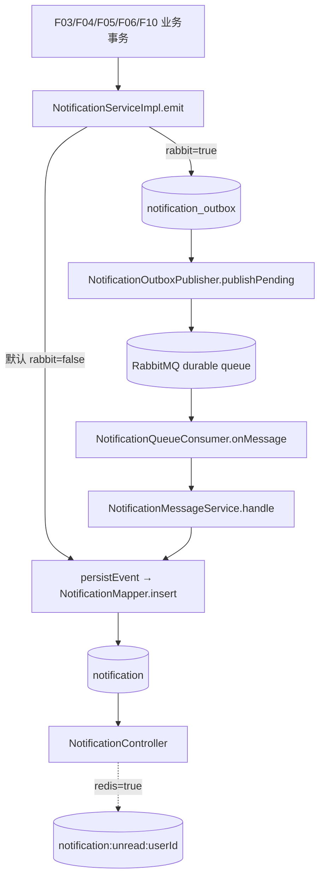

# F07 从代码学通知：同步 MySQL、可选 RabbitMQ 与 Redis

先看 `application.yml`：`forum.rabbit.enabled=false`、`forum.redis.enabled=false`。因此直接运行默认配置时，通知是**同事务写 MySQL**，未读数也是 MySQL `COUNT`。下面的 MQ/缓存链是开关打开才出现的代码路径，不能把它当作默认运行事实。

## 1. 数据和调用方

F03 帖子、F04 评论、F05 点赞/收藏、F06 关注、F10 私信可调用 `NotificationService.emit(recipient,actor,kind,target,eventKey,content)`。`recipient` 是收件人，`actor` 是动作人；相同则跳过。`eventKey` 是业务事件的稳定去重键；`notification` 表的唯一约束阻止重复通知。`notification_outbox` 在 MQ 模式存待发布事件。`NotificationEntity` 是数据库行，`NotificationVO` 不暴露收件人和事件键。

## 2. 默认链：通知怎样和业务保持一致

业务 Service 调用 `emit` → 自己通知自己直接返回 → `persistEvent` 先 `NotificationMapper.hasEvent` → `insert`，撞唯一键则重查事件 → `evictUnread`。默认模式中 `emit` 由外层业务事务调用，通知插入和业务写库一起提交/回滚。注意 Spring 同类方法调用的事务代理细节：这里 `emit` 的外部代理建事务；`persistEvent` 是类内调用，实际沿用外层事务，不是靠它的 `@Transactional` 另起事务。

客户端 `GET /api/notifications/unread-count` → `NotificationController.unread` → `NotificationServiceImpl.unread` → 可选 `NotificationUnreadCache.get` → 未命中时 `NotificationMapper.unread(userId)` → 可选 `put`（60 秒）→ `UnreadCountVO`。`GET /api/notifications` → `list` 校验页码 → Mapper `list/count` 按用户和可选 kind 分页 → `toVo`。`PUT /{id}/read` → `read` → `markRead(id,userId)`，更新 0 行给 404；`PUT /read-all` → `readAll` → Mapper 只改本用户行。两种写法最后都 `evictUnread`，在事务 `afterCommit` 删除缓存；Redis 故障则仍以 MySQL 为准。

## 3. 可选 MQ 链：崩溃、重复和顺序

开 `forum.rabbit.enabled=true` 后，`emit` 不直接写通知，而是同业务事务检查/插入 `notification_outbox` 的 JSON 事件。`NotificationOutboxPublisher.publishPending` 定时取最早的 100 条，向 `forum.notification.x` 以 `created` 路由发送，等待最多 5 秒的 correlated publisher confirm，ACK 后才 `markPublished`。发送失败、broker 停机或未确认时 outbox 行保留，下轮重试。`RabbitMqConfig` 声明 durable 交换机、主队列和死信队列。`NotificationQueueConsumer.onMessage` 反序列化，`NotificationMessageService.handle` 调 `persistEvent`；成功返回才由容器 ACK，处理失败按配置重试最多 3 次，随后可进死信队列。

这解决的是“业务提交了但 MQ 临时不可用”的事件保留；**不保证恰好一次投递**。若 broker 已接收、发布者尚未把 outbox 标已发就崩溃，下一次会重发；消费端靠 `eventKey` 唯一键做幂等。publisher confirm 证明 broker 确认发布，不单独证明消息已经落到目标队列；当前代码没有额外的 unroutable-return 校验。多发布实例、并发消费者和失败重试也不保证“同一收件人严格按业务发生顺序展示”；页面排序看 `notification` 表实际查询规则。需要严格顺序时要加用户维度序号、单分区/串行处理和缺口补偿，而当前代码未实现。死信队列只留待排查，当前未见自动人工重放流程。

## 4. Redis 的 KV 到底是什么

仅开 `forum.redis.enabled=true` 时，`NotificationUnreadCache.key` 形成 `notification:unread:<userId>`；value 是未读数量的字符串，TTL 60 秒。它是可丢弃的查询快照，**不是通知真值**。缓存雪崩时请求会回源 MySQL；当前没有对这个 key 做 TTL 抖动、互斥重建或限流。`evictUnread` 在提交后执行以减少旧事务回填，但删除失败或并发填充仍可能短暂读旧数，最长依赖 TTL 恢复。Redis 整体停机时 `get/put/evict` 的异常被兜底，未读数仍从 MySQL 查；高并发回源可能压垮 MySQL，当前代码没有证明能扛住缓存雪崩。

## 5. 方法地图与面试追问

| 方法 | 作用 |
| --- | --- |
| `NotificationController.unread/list/read/readAll` | HTTP 参数与可信用户 → Service |
| `emit/persistEvent` | 业务发事件、去自通知、去重，决定同步插库或 outbox |
| `unread/list/read/readAll` | 未读 COUNT、分页、本人已读更新 |
| `evictUnread/toVo` | 提交后清缓存、Entity 投影为响应 |
| `NotificationMapper.insert/hasEvent/unread/list/count/markRead/readAll/map` | 通知表的 SQL 与行映射 |
| `NotificationOutboxMapper.insert/hasEvent/pending/markPublished` | 待发事件表操作 |
| `publishPending/onMessage/handle` | MQ 发布、消费、转入共同落库逻辑 |
| `NotificationUnreadCache.get/put/evict/key` | 可选 Redis 计数快照 |

练习：先在默认配置触发一条评论通知，检查业务行与 `notification` 同时出现；同一 `eventKey` 发两次，只留一条；用 B 的 Token 尝试已读 A 的 id。然后在独立环境打开 MQ，停 broker 后提交业务，检查 outbox 未发布，恢复后看通知入库；重复投递同一 JSON 检查幂等。打开 Redis 后对照 `notification:unread:<userId>`、MySQL COUNT 和 TTL，再停 Redis 观察回源。MQ/Redis 实验必须真的启用服务，不能仅看单元测试或 POM 依赖。
