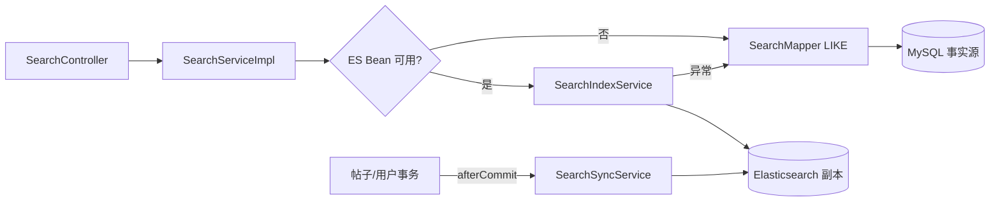

# F08 从 0 做方案：搜索、索引同步与降级

> 搜索不是把 SQL 换成 Elasticsearch。真正设计问题是：谁是事实源、索引怎样重建、同步失败怎样恢复、结果怎样安全高亮、ES 挂掉时产品还能不能用。

## 1. 为什么要实现

用户需要按关键词找帖子和用户，并按相关性或时间排序。MySQL LIKE 能完成小数据第一版；数据量和中文检索需求增长后，倒排索引才能提供更好的分词、相关性和性能。

## 2. 从零会遇到的问题

1. **第一版直接上 ES 还是先用 MySQL？**  
   **本项目回答：** 默认用参数化 MySQL/H2 LIKE，确保零外部依赖可运行；ES 是显式开关后的性能与相关性增强。
2. **MySQL 与 ES 谁是主数据？**  
   **本项目回答：** MySQL 是唯一事实源，ES 是可删除、可重建的搜索副本，绝不从 ES 反向决定业务状态。
3. **发帖事务回滚时 ES 会不会已有脏文档？**  
   **本项目回答：** 同步安排在事务提交后，回滚不会触发索引写入；这解决了“回滚脏文档”，没有解决“提交后同步失败”。
4. **MySQL 已提交但 ES 同步失败怎么办？**  
   **本项目回答：** 当前记录失败并可全量重建，查询异常时降级 MySQL；生产应加 Outbox/MQ/CDC 和同步延迟监控。
5. **全量重建期间是否停搜索？**  
   **本项目回答：** 不停。新建版本化索引并批量导入，旧 alias 继续服务。
6. **怎样确认完整后切流？**  
   **本项目回答：** 完成数量/抽样校验后原子切换 alias；失败则删除新索引，旧索引不受影响。
7. **中文分词选 standard 还是 IK？**  
   **本项目回答：** 当前使用部署门槛低的基础分析器，因此中文效果有限；IK 等插件效果更好，但所有节点必须安装同版本并管理词典。
8. **输入 `%`、`_` 或 HTML 怎么办？**  
   **本项目回答：** LIKE 特殊字符先转义且参数仍绑定；高亮先 HTML escape 原文，再插入服务端固定 em 标签，防止 XSS。
9. **ES 与 MySQL 排序能完全一致吗？**  
   **本项目回答：** 不能。ES 按相关性评分，LIKE 主要按结构化排序；降级时必须接受结果顺序和召回差异。
10. **深分页为什么危险？**  
    **本项目回答：** from/size 要让每个分片收集并排序大量候选，内存和 CPU 随页数增长；应使用 search_after/PIT。
11. **敏感字段能进搜索索引吗？**  
    **本项目回答：** 不能。用户索引只放允许公开检索的字段，邮箱、手机号、密码哈希不应复制到搜索系统。

## 3. 两级方案

### 默认路径

`forum.search.elasticsearch.enabled=false`。`SearchMapper` 用参数化 MySQL/H2 LIKE；关键词中的 `%/_/!` 先转义，值仍通过 `?` 绑定。

### 可选路径

开启开关后创建 `SearchIndexServiceImpl`。查询优先 ES，任何运行异常回退 MySQL。帖子/用户改变后，`SearchSyncServiceImpl` 在数据库事务提交后按 id 同步。

## 4. 技术选型与替代方案

| 部分 | 当前选择 | 为什么选 | 没选什么，为什么 |
| --- | --- | --- | --- |
| 第一版搜索 | 参数化 LIKE | 零外部依赖、行为容易验证 | 一开始只用 ES 会让开发环境和主功能绑定中间件 |
| 进阶引擎 | Elasticsearch REST API | 倒排、权重、相关性、索引别名成熟 | Solr 同样可行但生态选择不同；OpenSearch 可替代但当前未部署 |
| ES 客户端 | JDK `HttpClient` 网关 | 依赖少、请求 JSON 可直接观察 | Spring Data ES 更方便但版本耦合和抽象更多 |
| 数据角色 | MySQL 真相，ES 可重建副本 | 交易、约束和事务留在关系库 | 把 ES 当主库会使关系一致性和恢复更难 |
| 增量同步 | transaction afterCommit | 回滚不写索引 | 事务内同步拉长锁且仍非原子；直接先写 ES 会产生幽灵文档 |
| 全量重建 | 新物理索引 + 数量核对 + alias 原子切换 | 读请求不必停机，失败不切换 | 原地清空重建期间会无结果或半结果 |
| 高亮 | 先 HTML 转义，再插固定 `<em>` | 不信任源文本，防高亮 XSS | 直接拼 `<em>` 到原文会执行恶意 HTML；当前未用 ES 原生片段 |
| 深分页 | 超过 10000 拒绝 | 防止昂贵 from/offset | ES `search_after` 更适合深翻页，但接口更复杂 |

## 5. 每项技术负责什么

- `SearchDTO`：关键词、页码、大小和排序。
- `SearchServiceImpl.check`：空词、超长、深页和排序白名单。
- `SearchMapper`：默认 SQL 搜帖子/用户，且只选公开字段。
- `SearchHighlighter`：转义后做受控完整关键词高亮。
- `ElasticsearchConfig.ElasticsearchGateway`：HTTP、认证、JSON 和错误处理。
- `SearchIndexServiceImpl`：mapping、增量同步、查询、全量重建和 alias。
- `SearchSyncServiceImpl`：事务提交后触发；失败只记录并允许重建恢复。
- `SearchMaintenanceController`：管理员手动重建入口。

## 6. 为什么全量重建要新索引和别名

若直接删旧索引再导入，导入几分钟内搜索为空；中途失败还会留下半成品。当前方案创建时间戳物理索引，用主键游标分批导入，refresh 后比较文档数；只有数量一致才用 `_aliases` 一次切换。

数量一致只是最低检查，不证明每个字段都正确。生产还应抽样校验版本/更新时间、保留旧索引用于回滚，并在确认后清理。

## 7. 缺陷台账

| 缺陷/后果 | 状态 | 结论 |
| --- | --- | --- |
| 真实 Elasticsearch 尚未集成验证 | **未验证** | mapping、认证、版本兼容、恢复流程需真实运行 |
| afterCommit 增量失败会陈旧 | **可重建但不可靠投递** | 当前记录日志；生产应使用 Outbox/MQ 或 CDC |
| 默认 `standard` 中文分词一般 | **已知缺陷** | 不依赖插件便于启动；生产中文检索可安装 IK/其他分析器并重建索引 |
| MySQL fallback 与 ES 相关性不同 | **可接受降级** | 降级目标是“还能搜”，不是排名完全一致 |
| 应用层高亮只匹配完整关键词 | **简化实现** | 不支持分词片段；ES 原生 highlight 需同样做安全处理 |
| `from` 深分页成本高 | **已限制 10000** | 再大用 `search_after` + 稳定排序键 |
| 数量核对无法发现内容陈旧 | **未完全解决** | 增加 sourceUpdatedAt、抽样 checksum 或对账任务 |
| 旧物理索引不会自动清理 | **故意保留但需运维** | 便于回滚；应设置保留数量和清理任务 |
| 搜索失败直接捕获所有 RuntimeException | **可用但观测不足** | 用户获得降级结果；需指标区分 ES 故障和代码缺陷 |

## 8. 为什么不用 MySQL FULLTEXT

它是合理替代，部署简单且比 `%LIKE%` 更强。但中文分词、相关性调节、字段权重、索引重建和扩展能力通常不如专用搜索引擎。当前教学路线先 LIKE，随后用 ES 展示副本与降级设计；不代表 FULLTEXT 错。

## 9. 面试追问

**问：MySQL 和 ES 怎样保证强一致？** 当前不保证跨系统强一致。MySQL 是真相，提交后尽力同步；失败可全量重建。生产可用 Outbox/MQ/CDC 缩小窗口并监控延迟。

**问：为什么 afterCommit 比事务内调用 ES 好？** 回滚时不会留下 ES 脏文档，也不把网络延迟放进数据库事务；代价是提交后失败需要补偿。

**问：别名切换解决什么？** 新索引完整前旧索引继续服务；切换动作原子，用户不会看到中间半成品。

**问：怎样防搜索高亮 XSS？** 先转义数据库文本，再只插入服务端固定 `<em>` 标签，不能把 ES/用户返回的任意 HTML直接交给 `v-html`。

### 9.1 面试官还能怎样继续追问

**延伸：mapping 为什么要提前设计？** 字段一旦以错误类型写入，通常不能原地改成另一类型；要建新索引、reindex、校验并切 alias，所以动态 mapping 在生产需谨慎。

**延伸：refresh_interval 是什么代价？** 更短 refresh 让新文档更快可搜，但增加 segment 创建、合并和 IO；搜索实时性不是免费强一致，应按业务延迟要求设置。

**延伸：分片越多越好吗？** 不是。过多小分片增加堆内存、集群状态和查询 fan-out；过大分片又影响迁移恢复。需按数据量、节点和恢复目标规划。

**延伸：search_after 为什么常配 PIT？** search_after 解决深分页成本，PIT 固定查询视图，避免翻页期间索引刷新导致排序边界变化；排序还必须包含唯一 tie-breaker。

## 10. 源码与验证

- API：`SearchController → SearchServiceImpl`。
- 默认：`SearchMapper`。
- 可选 ES：`ElasticsearchConfig`、`SearchIndexServiceImpl`、`SearchSyncServiceImpl`。
- 安全：`SearchHighlighter`。
- 测试：`SearchHighlighterTest` 和 `FeatureFlowApiTest` 的默认 MySQL 搜索；真实 ES 未验证。

## 11. 学习完成检查（先回答，再点击展开）

自测 1：为什么 Elasticsearch 不是本项目的主库？

**参考回答：** 用户、帖子、标签和治理依赖关系事务与唯一约束；ES 用于检索和相关性，文档可由 MySQL 重建。业务写入先落 MySQL，不能因 ES 异常丢失主数据。

自测 2：请说出零停机全量重建的步骤。

**参考回答：** 创建版本化新索引和 mapping，批量从 MySQL 导入，校验数量与样本，原子把 alias 从旧索引切到新索引，观察稳定后再删除旧索引；失败时旧 alias 继续服务。

自测 3：增量同步失败后当前项目和生产方案分别怎样恢复？

**参考回答：** 当前可降级 MySQL 查询并手工/全量重建；生产应把变更写入 Outbox 或使用 CDC，经 MQ 重试，监控同步延迟和 DLQ，同时保留全量重建兜底。

