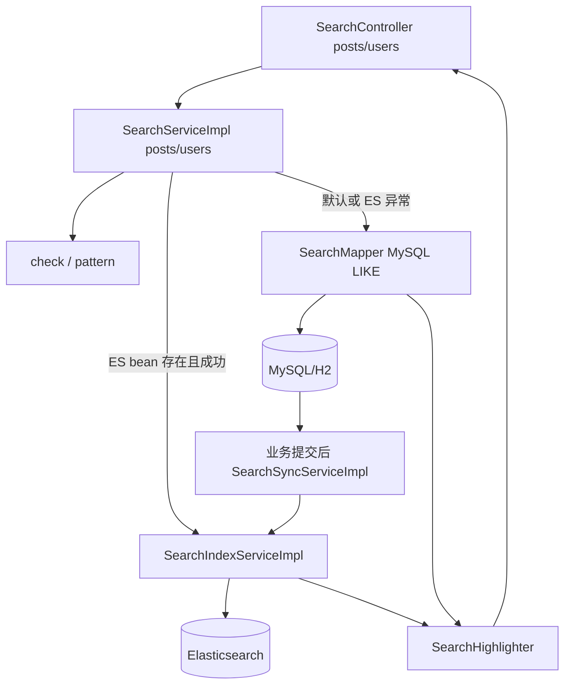

# F08 从代码学搜索：MySQL 回退与可选 Elasticsearch

默认 `forum.search.elasticsearch.enabled=false`，搜索走 MySQL 参数化 `LIKE`；打开开关才创建 ES 服务。阅读顺序：`SearchController` → `SearchServiceImpl` → `SearchMapper`，再看 `SearchSyncServiceImpl`、`SearchIndexServiceImpl` 和 `ElasticsearchConfig`。本笔记描述重建项目当前实现，原版 ZiJingForum 的技术选型需另外以原版代码为证。

## 1. 索引与响应不是一回事

MySQL 中 `post/user_account/user_profile/tag` 是权威数据。`SearchMapper` 的 SQL 过滤只查已发布帖和可搜索用户；ES 文档是从这些行生成的副本。`SearchDTO` 保存关键词、页码、页大小和排序；`PostSearchVO/UserSearchVO` 是响应，不含用户敏感字段。`SearchHighlighter.highlight` 先转义文本，再插入固定的 `<em>` 标记，避免把数据库/用户文本直接当 HTML 返回。

## 2. 用户搜一遍，方法怎么接

`GET /api/search/posts?q=java&page=1&size=20&sort=relevance` → `SearchController.posts` 把 `q`（或 `keyword`）装成 `SearchDTO` → `SearchServiceImpl.posts` → `check`（关键词 1～100、size 1～100、offset 小于 10000、排序仅 `relevance/latest`）→ 如果 `ObjectProvider<SearchIndexService>` 有 bean，就试 `es.posts`；抛运行异常则记日志并回退 → `pattern` 把 `!/%/_` 转义，小写后经 `?` 参数绑定 → `SearchMapper.posts/countPosts` → `SearchHighlighter.highlight(title/summary)` → `PageResponse`。搜用户同样走 `users`，Mapper JOIN 资料表，高亮账号和昵称。

MySQL 回退保障 ES 停机时接口仍有基本搜索；`LIKE` 对大表、中文分词、相关性排序能力较弱。ES 使用倒排索引可改善全文检索，代价是多一份索引、网络和最终一致性。当前 mapping 用标准 analyzer，并不能声称已安装 IK 中文分词。深分页限制是保护，不等于已解决海量结果翻页；游标/search_after 是后续方向。

## 3. 业务更新怎样到索引

F01/F02/F03/F11 的相关写 Service 在数据库事务里调用 `SearchSyncService.userChanged/postChanged`；`SearchSyncServiceImpl` 注册 `afterCommit` 回调，提交后才调用 `SearchIndexServiceImpl.syncUser/syncPost`。`syncPost/syncUser` 先 `ensure` 索引/别名，再用 `SearchMapper.indexPost/indexUser` 从**数据库重读当前完整状态**；可见就按 ID PUT，不可见或删除就 DELETE。这样 ES 不拿客户端旧 DTO 作真值，更新多次时最终可按 MySQL 当前状态重建。`refresh=wait_for` 改善写后可见性，却增加索引成本。

**关键缺口**：提交后同步失败只记日志，没有把增量事件持久化到 outbox；服务在提交和回调之间崩溃也会漏索引。搜索请求只在 ES 抛异常时回退 MySQL，ES 可用但索引陈旧时不会自动察觉。`SearchMaintenanceController` 的管理员重建是修复手段，不能把它说成自动实时一致性保障。

## 4. 重建和方法地图

`SearchMaintenanceController` → `SearchIndexServiceImpl.rebuild` → `rebuildPosts/rebuildUsers`：建立新版本物理索引 → `SearchMapper.postIdsAfter/userIdsAfter` 游标每批 200 条 → `indexPost/indexUser` 取源数据并批量写 → `_refresh` 与数量校验 → `switchAlias` 切别名。重建期间旧别名仍服务请求；切换前仍可能有新写入，需要结合增量重放或短暂停写验证最终一致性，当前代码不能凭一次 count 校验保证零漏项。

| 方法 | 关系 |
| --- | --- |
| `SearchController.posts/users` | 接 HTTP 参数并调用 Service |
| `SearchServiceImpl.posts/users` | `check` → ES 优先/SQL 回退 → 高亮 VO |
| `check/pattern` | 输入边界和 LIKE 转义；值仍走 JDBC 参数 |
| `SearchMapper.posts/countPosts/users/countUsers` | 默认查询与总数 |
| `indexPost/indexUser/postIdsAfter/userIdsAfter/publishedPostCount/searchableUserCount` | ES 源数据和重建游标/校验 |
| `SearchSyncServiceImpl.postChanged/userChanged` | 业务提交后的增量同步 |
| `SearchIndexServiceImpl.syncPost/syncUser/ensure/posts/users/rebuild` | ES 索引维护和查询 |
| `SearchHighlighter.highlight` | 文本转义与命中强调 |

## 5. 实操与面试追问

默认配置搜一篇新帖，试关键词 `%` 与 `_`，说明为什么不会匹配全站；搜被封禁用户和删除帖，核对 SQL 可见性。开 ES 后新建/编辑/删除帖子，分别查 MySQL、ES 和 API；停 ES 后请求应回退 SQL。再让 ES 在业务提交之后恢复，观察是否需要管理员重建。面试回答要区分“为什么选择 ES”（全文索引需求）、“为什么保留 MySQL”（事务真值和故障回退）和“当前缺陷”（增量同步不可靠、索引可能陈旧、中文分词未优化、深分页上限），不要承诺代码尚未提供的强一致性。
