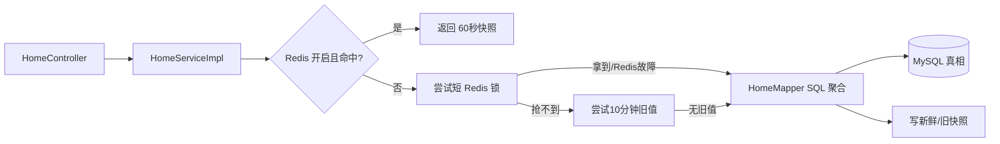

# F09 从 0 做方案：首页统计、热门标签与缓存

> 首页看似只是四个数字，实际会考统计口径、时间边界、聚合成本、缓存穿透/击穿、Redis 故障降级和数据新鲜度。

## 1. 为什么要实现

首页需要快速展示总用户、总帖子、今日/昨日帖子数和热门标签。它们都可以从主表计算，但访问频率高、结果在短时间内变化不大，是缓存的典型候选。

## 2. 从零会遇到的问题

1. **总用户和总帖子的统计口径是什么？**  
   **本项目回答：** 总用户排除 BANNED；总帖子只统计 PUBLISHED 且未删除。口径先固定，缓存只保存结果，不能反过来决定业务定义。
2. **“今天”使用哪个时区？**  
   **本项目回答：** 校园论坛统一使用 Asia/Shanghai 业务时区，不依赖服务器默认时区，避免换机器后统计漂移。
3. **怎样避免午夜记录同时属于两天？**  
   **本项目回答：** 使用半开区间 `[start,end)`；今天结束点正好是明天开始点，边界不会重复。
4. **热门标签按冗余 use_count 还是实时关系 COUNT？**  
   **本项目回答：** 当前从有效 post 与 post_tag 实时聚合，保证删除/状态变化后口径正确；数据大后才考虑增量统计和对账。
5. **每次多条 COUNT/GROUP BY 会不会慢？**  
   **本项目回答：** 小数据和正确索引下可接受；默认先保证 SQL 真值，Redis 开启后缓存聚合结果，是否预聚合要由慢查询指标决定。
6. **Redis 挂了返回什么？**  
   **本项目回答：** 捕获缓存异常并回源 MySQL，不能返回假的 0。代价是故障时数据库压力陡增，需要超时、熔断和容量预案。
7. **缓存失效时大量请求同时回源怎么办？**  
   **本项目回答：** overview 使用短锁和 stale 值做有限缓解；没有 stale 或 hotTags 路径仍可能并发回源，所以当前不能声称彻底解决击穿。
8. **TTL 多久，能允许多旧？**  
   **本项目回答：** 首页统计允许短时间陈旧，TTL 是产品新鲜度与数据库压力的取舍；交易余额等强一致数据不能照搬。
9. **`limit=5` 与 `limit=50` 能共用 key 吗？**  
   **本项目回答：** 不能，所有影响结果的参数都必须进入 key，否则小列表和大列表会互相污染。
10. **为什么不先做定时统计表？**  
    **本项目回答：** 当前 SQL 能直接算真值，统计表会引入写链维护、失败补偿和重算。监控证明聚合昂贵后再演进更合理。

## 3. 先固定口径，再写代码

- 总用户：`status <> BANNED`。
- 总帖子：`status=PUBLISHED AND deleted_at IS NULL`。
- 今日/昨日：Asia/Shanghai 的半开区间 `[start,end)`。
- 热门标签：有效帖子与 `post_tag` 的实时关系 COUNT。

口径是产品规则，不是 SQL 细节。如果面试时只说“用了 Redis”，却说不清数字怎么算，方案仍是不完整的。

## 4. 默认与可选路径

默认 Redis 关闭，始终走 MySQL。开启后缓存只是可丢弃快照；任何 Redis 异常都不得伪造成 0，而是回源 SQL。

## 5. 技术选型与替代方案

| 部分 | 当前选择 | 为什么选 | 没选什么，为什么 |
| --- | --- | --- | --- |
| 第一版统计 | 实时 SQL COUNT/GROUP BY | 口径直观，数据强一致 | 冗余统计表写入复杂，先证明查询真的慢 |
| 缓存 | Redis Cache Aside | 跨实例共享、TTL、故障可回源 | JVM Caffeine 更简单但实例间不共享；仍可作为单机替代 |
| 新鲜度 | 60 秒 fresh + 10 分钟 stale | 允许短暂旧数据换可用性 | 永不过期会长期错误；每次写业务主动更新耦合太多模块 |
| 防击穿 | 短 Redis 锁 + 旧值 | 只让少量请求刷新，其余先看旧值 | 全部请求阻塞等待锁会增加尾延迟 |
| 解锁 | token + Lua 比较删除 | 防止锁过期后误删别人新锁 | 直接 DEL 有误删风险；完整 Redisson 功能当前不需要 |
| 时间 | `Clock` + 固定 Asia/Shanghai | 可测试，业务日边界明确 | 直接散落 `now()` 难以测试；按每用户时区会改变全站口径 |
| 热门标签 | 实时有效关系 COUNT | 删除/驳回帖不贡献热度 | 直接信 `tag.use_count` 读快但可能漂移 |

## 6. 为什么缓存 key 必须含参数

热门标签的结果由 `limit` 决定，所以 key 是 `home:tags:{limit}`。如果所有 limit 共用一个 key，先请求 5 条后再请求 20 条只会拿到 5 条。这是缓存键必须覆盖所有影响结果的输入参数。

## 7. 缺陷台账

| 缺陷/后果 | 状态 | 结论 |
| --- | --- | --- |
| 真实 Redis 尚未集成验证 | **未验证** | 代码有降级，仍需真实宕机、超时和序列化测试 |
| 首页一次执行多条 COUNT | **当前可接受** | 数据小；先建正确索引和测慢查询，再考虑预聚合 |
| 热门标签没有加刷新锁 | **可能击穿** | 当前查询较轻且 TTL 短；规模上来可复用单飞/锁策略 |
| 抢不到锁且没有 stale 时仍会回源 | **有有限击穿窗口** | 优先保证可用；不能声称完全解决缓存击穿 |
| 缓存最多短暂陈旧 | **预期取舍** | 统计展示允许秒级/分钟级延迟；交易结果不能照搬此策略 |
| 锁没有续租 | **可接受短任务** | TTL 5 秒且聚合应很短；超时慢查询需监控和更成熟锁实现 |
| 固定上海时区不适合全球用户个性化“今日” | **产品定义** | 校园论坛采用统一业务时区；若国际化需重定义口径 |
| 无缓存命中率、回源次数、查询耗时指标 | **未解决** | 生产优化前必须先加 metrics，不能凭感觉调 TTL |
| 热门只按使用次数，缺少时间衰减 | **产品简化** | 可增加时间窗口/热度公式，但先明确业务目标 |

## 8. 为什么不先做统计表

统计表或事件聚合适合大数据和复杂报表，但会增加每个写操作的维护、失败补偿和重算逻辑。当前四个数字能由索引良好的 SQL直接得到，缓存已经能减少重复计算。只有监控证明聚合慢或数据量显著增长，才值得引入增量统计表。

## 9. 面试追问

**问：Redis 挂了首页会怎样？** 捕获缓存异常并回 MySQL，返回真实结果，不返回 0。代价是数据库压力增加，需要熔断、超时和容量预案。

**问：缓存击穿真的解决了吗？** 部分缓解。overview 有短锁和 stale 值，但无 stale 时仍回源，hotTags 也没有锁；不能夸大为彻底解决。

**问：为什么用半开时间区间？** `[今天00:00, 明天00:00)` 与 `[昨天00:00, 今天00:00)` 不重叠，午夜记录只属于一天。

**问：为什么不主动在每次发帖后更新缓存？** 会让发帖、删除、审核等多个模块都耦合缓存规则。当前 TTL + 回源简单可靠；若新鲜度要求提高，可统一发布失效事件。

### 9.1 Redis 高频追问专题

**问：缓存穿透是什么，本项目怎样处理？** 穿透是请求不存在的数据，缓存永远没有而持续打数据库。首页参数范围固定，先做 limit 校验；通用方案还包括短 TTL 空值缓存和 Bloom Filter，但后者有误判且要维护。

**问：缓存击穿是什么，本项目彻底解决了吗？** 击穿是单个热点 key 过期时大量请求同时回源。overview 使用短锁和 stale 值缓解，但首次无 stale、锁过期以及 hotTags 都仍可能回源，所以没有彻底解决。

**问：缓存雪崩是什么？** 大量 key 同时过期、Redis 故障或网络隔离导致数据库瞬间承压。常见措施是 TTL 加随机抖动、多级缓存、高可用 Redis、限流熔断和数据库容量预案。

**问：缓存与数据库怎样保持一致？** 当前把 MySQL 当真相，缓存只是短 TTL 快照；写路径不复杂双写，依靠失效/过期。高一致要求可采用先更新数据库再删缓存、延迟双删或变更事件，但仍要处理竞态和失败重试。

**问：热 key、大 key 有什么问题？** 热 key 会让单分片和网络成为瓶颈，大 key 会阻塞序列化、传输和删除。可拆分 key、本地短缓存、请求合并、异步 UNLINK，并通过监控先定位。

**问：为什么锁必须带 token 并用 Lua 解锁？** 锁可能过期后被别人获取；旧持有者若直接 DEL 会删掉新锁。Lua 要原子比较 value 是否仍是自己的随机 token，再删除。

## 10. 源码与验证

- 主链：`HomeController → HomeServiceImpl → HomeMapper`。
- 缓存：`HomeCache`。
- 短锁：`RedisLockUtils`。
- 测试：默认 SQL 路径在 `FeatureFlowApiTest.commentsInteractionsFollowSearchAndHome`；真实 Redis 未验证。

## 11. 学习完成检查（先回答，再点击展开）

自测 1：请分别定义缓存穿透、击穿和雪崩，并各给一个方案。

**参考回答：** 穿透是查询不存在数据持续回源，可空值缓存/Bloom Filter；击穿是热点 key 失效并发回源，可互斥重建/stale-while-revalidate；雪崩是大量 key 或整个 Redis 同时失效，可 TTL 抖动、高可用、限流熔断和容量预案。

自测 2：为什么本项目只能说“缓解击穿”？

**参考回答：** overview 有短锁和 stale，但首次加载没有 stale 时抢不到锁的请求仍会回源；hotTags 没有刷新锁，锁也没有续租。代码优先可用性，没有实现严格单飞。

自测 3：如果 Redis 完全宕机，首页为什么不能返回 0？

**参考回答：** 0 是错误业务数据，会误导用户；Redis 不是事实源，异常应快速失败并回源 MySQL。与此同时必须限流、熔断和监控，避免所有流量同时把数据库压垮。

自测 4：统计功能优化前为什么要先明确口径？

**参考回答：** 缓存和预聚合只会更快地返回某个数字，不能决定数字是否正确；必须先定义状态过滤、删除过滤、业务时区和半开区间，才能写 SQL、缓存 key 与测试。

