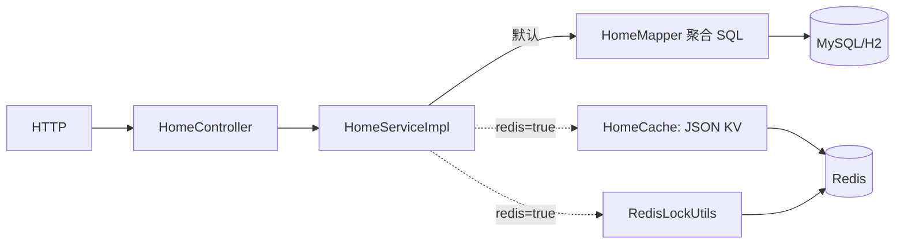

# F09 从代码学首页统计：SQL 口径、Redis 快照和回源

打开 `HomeController`、`HomeServiceImpl`、`HomeMapper`、`HomeCache` 与 F05 的 `RedisLockUtils`。默认 `forum.redis.enabled=false`，请求直接查数据库；Redis 只在开关打开后缓存**可丢弃快照**。

## 1. 两个接口与数据含义

`GET /api/home` 返回 `HomeStatisticsVO(users,posts,todayPosts,yesterdayPosts,calculatedAt)`；`GET /api/home/hot-tags?limit=10` 返回标签名和使用数。`HomeMapper.users` 只数未 `BANNED` 用户；`posts` 只数 `PUBLISHED` 且 `deleted_at IS NULL` 的帖；`postsBetween(start,end)` 用半开区间 `[start,end)`；`hotTags` JOIN `tag/post_tag/post`，只让有效帖贡献热度。用户看到的“总数”是上述 SQL 口径，不是表里所有行。

## 2. 首页 `/api/home` 真正怎样执行

`HomeController.overview` → `HomeServiceImpl.overview` → 可选 `HomeCache.overview` 读 60 秒新鲜值；命中直接返回。未命中时可选 `RedisLockUtils.tryLock("lock:home:overview",5 秒)`。抢不到锁时尝试 `HomeCache.staleOverview` 的 10 分钟旧值；连旧值也没有就继续回源。抢到锁或不用 Redis 时，`Clock` 以 `Asia/Shanghai` 算今日 00:00 → `HomeMapper.users/posts/postsBetween(今日,明日)/postsBetween(昨日,今日)` → 组 `HomeStatisticsVO` → 可选 `HomeCache.saveOverview` 同时写新鲜/旧快照 → `finally` 释放锁。Redis 任何读写异常都被 Service 兜底，返回真实 SQL 结果。

`RedisLockUtils` 放在 F05 包不代表点赞用了 Redis 锁；实际调用在这里。锁只减少缓存过期同时重建时的回源，不构成数据库一致性锁。5 秒锁租期内若 SQL 很慢，可能有多个请求并行回源；当前也没有等待锁持有者刷新后再重读新鲜缓存。

## 3. 热门标签 `/hot-tags` 真正怎样执行

`HomeController.hotTags` → `HomeServiceImpl.hotTags` 先限制 `limit` 1～50 → `HomeCache.hotTags(limit)` 可选读缓存 → 未命中/Redis 故障就 `HomeMapper.hotTags(limit)` → 可选 `saveHotTags`（60 秒）→ 返回。此路径没有 Redis 锁和 stale 旧值，热门标签 key 按 limit 分开，避免 `limit=5` 误用 `limit=20` 的列表。

## 4. 方法表和 KV 具体值

| 方法或 key | 内容 |
| --- | --- |
| `HomeController.overview/hotTags` | HTTP 参数与 `ApiResponse` 包装 |
| `HomeServiceImpl.overview/hotTags` | 缓存优先、SQL 回源、时间与 limit 规则 |
| `HomeMapper.users/posts/postsBetween/hotTags` | 各自固定的 SQL 统计口径 |
| `HomeCache.overview/staleOverview/saveOverview` | `home:overview`：统计 VO 的 JSON，60 秒；`home:overview:stale`：同一 VO JSON，10 分钟 |
| `HomeCache.hotTags/saveHotTags` | `home:tags:<limit>`：`HotTagVO` 数组 JSON，60 秒 |
| `HomeCache.read/write` | Jackson 编解码与 `StringRedisTemplate.opsForValue`、TTL |
| `RedisLockUtils.tryLock/release` | `lock:home:overview`：短租期锁 token，释放须匹配 token |

## 5. 为什么 Redis 在这里有用，边界是什么

首页统计每次要执行多条 COUNT/JOIN；大量读请求会重复算同一份结果，故 Redis 缓存能减少数据库聚合压力。与直接在 Java 进程里缓存相比，多实例共享同一份快照；代价是部署/故障面增加和最多 60 秒的统计滞后。Redis 崩了时 SQL 回源保证数据来源正确，但若所有 key 同时过期或 Redis 整体停机，高并发流量会同时打到 DB。当前代码对首页使用锁+旧值；热门标签没有锁；TTL 没随机抖动、没有限流，因此不能声称已彻底解决缓存雪崩。业务写入也不主动失效这些 key，读到短期旧数是当前设计允许的。

动手：创建一篇帖子后立即访问首页，再等超过 60 秒；对照 `post` 表与缓存 JSON 的 `calculatedAt`。用固定 `Clock` 测午夜边界；停 Redis 看是否回源；并发压测 key 失效瞬间的 MySQL COUNT 次数，再决定是否需要 TTL 抖动、限流或预计算。没有负载数据，就只能说这些是可能瓶颈，不能宣称已发生。
