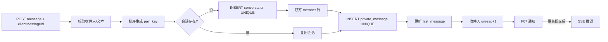

# F10 从 0 做方案：持久化私信、幂等发送与 SSE

> 私信不是“开一个 WebSocket”就结束。正确顺序是先保证消息持久化、会话授权、幂等和未读状态，再把 SSE/WebSocket 当作实时体验层。

## 1. 为什么要实现

用户需要一对一私下交流。核心承诺是：发送成功的消息重启后仍存在，网络重试不会重复，对方不能猜会话 id 越权读取，离线后重新上线能补齐历史。

## 2. 从零会遇到的问题

1. **怎样保证两个人只有一个会话？**  
   **本项目回答：** 把较小 userId 放前面生成排序 `pair_key`，数据库 UNIQUE 使 A→B 与 B→A 命中同一会话。
2. **双方同时发送第一条消息，谁创建会话？**  
   **本项目回答：** 两边都可尝试 INSERT，唯一键只允许一个成功；另一个捕获冲突后查询已经创建的会话。
3. **请求超时重发怎样避免重复消息和两次未读？**  
   **本项目回答：** 客户端为一次发送复用稳定 `clientMessageId`，数据库唯一约束去重；只有真正插入新消息才增加未读和发通知。
4. **同一个 clientMessageId 被用于不同内容怎么办？**  
   **本项目回答：** 冲突后读取原消息并比较会话、类型和正文；不一致视为客户端协议冲突，不能静默返回旧消息。
5. **猜到 conversationId 能读取别人消息吗？**  
   **本项目回答：** 不能。查询、标记已读前都用 `conversation_member` 验证当前用户，非成员返回 404 以减少资源存在性泄露。
6. **消息列表用 OFFSET 还是游标？**  
   **本项目回答：** 使用 `beforeId` 游标；新消息插入不会移动已经翻过的边界，也避免深 OFFSET 扫描。
7. **未读数实时 COUNT 还是成员状态？**  
   **本项目回答：** `conversation_member` 保存每人的 unread_count 和 last_read_message_id，列表读取快；同事务维护并保留对账可能。
8. **SSE、WebSocket 和轮询怎样选？**  
   **本项目回答：** 当前用 HTTP POST 发送、SSE 单向通知。它比 WebSocket 简单；若需要输入状态、高频双向帧再升级。
9. **实时推送成功但数据库回滚怎么办？**  
   **本项目回答：** SSE 只在事务 `afterCommit` 后执行，避免幽灵消息；推送失败则靠历史接口补拉。
10. **断线、重启、多实例和慢客户端怎么办？**  
    **本项目回答：** 历史消息保证可恢复，但当前 SSE Hub 只在单 JVM，心跳、跨实例广播、背压和连接指标仍未完成。
11. **图片、撤回、拉黑和删除会话做了吗？**  
    **本项目回答：** 没有，当前只明确支持 TEXT。新增这些能力前必须分别定义存储、授权、对方可见性和审计语义。

## 3. 三张表各解决一个问题

- `conversation(pair_key,last_message_id,last_message_at)`：会话身份和排序。
- `conversation_member(conversation_id,user_id,unread_count,last_read_message_id)`：成员资格与每个人的读状态。
- `private_message(conversation_id,sender_id,client_message_id,type,content,created_at)`：不可丢的消息历史。

`pair_key = min(userA,userB) + ':' + max(userA,userB)`，使 A/B 顺序无关；UNIQUE `pair_key` 防止并发建两个会话。UNIQUE `(sender_id,client_message_id)` 防止同一发送人的网络重试插两条。

## 4. 发送链

任何数据库步骤失败都会回滚。SSE 只在 afterCommit 运行，避免浏览器先看到一条最终不存在的消息。

## 5. 技术选型与替代方案

| 部分 | 当前选择 | 为什么选 | 没选什么，为什么 |
| --- | --- | --- | --- |
| 历史存储 | MySQL | 事务、持久、权限查询、游标分页 | 原项目内存 Map 重启丢；Redis 也不应无持久策略地当聊天主库 |
| 单聊唯一性 | 排序 `pair_key` + UNIQUE | A/B 顺序无关，多实例并发有效 | 只查双方 member 再创建存在竞态；两个方向各建会话会重复 |
| 发送幂等 | 客户端 UUID + UNIQUE | 请求超时可安全重试 | 服务端无法仅凭正文判断是否同一意图；时间窗口去重会误判 |
| 事务隔离 | READ_COMMITTED + 条件/唯一约束 | 避免读脏，依赖数据库约束解决竞争 | SERIALIZABLE 更强但锁与重试成本高；当前约束已能表达不变量 |
| 历史分页 | `beforeId` 游标 | 新消息插入不会移动旧页，索引友好 | OFFSET 在聊天增长时会重复/漏读且深页慢 |
| 未读状态 | member 行冗余计数 + lastReadId | 会话列表快速读取，双方独立 | 每次 COUNT 所有未读消息更贵；单一会话字段无法区分双方 |
| 实时通道 | SSE `SseEmitter` | 服务器只需单向通知浏览器，实现比 WebSocket 简单 | WebSocket 双向但发送仍需持久化 HTTP/协议，连接治理更复杂；轮询浪费请求 |
| 内容安全 | Jsoup 纯文本 | 当前只支持 TEXT，减小 XSS 面 | 富文本/图片消息需要独立类型和对象存储规则 |

## 6. 为什么历史数据库比实时通道更重要

SSE 连接会断、服务会重启、浏览器会睡眠。实时推送只能告诉在线客户端“有新消息”，不能作为唯一交付证明。客户端重连后必须拿最后已知 messageId 调历史接口补拉。

因此即使 SSE 失败，消息仍已在 `private_message`；体验稍慢但数据不丢。反过来如果只推 SSE 不落库，离线用户永远收不到。

## 7. 权限设计

查询历史和标记已读前都调用 `requireMember(userId, conversationId)`。返回 404 而不是 403，避免向非成员泄露“这个会话确实存在”。

会话列表的 SQL 也从 `conversation_member` 按当前 userId 开始，而不是先查全部会话再在 Java 过滤。

## 8. 缺陷台账

| 缺陷/后果 | 状态 | 结论 |
| --- | --- | --- |
| SSE 连接只在单 JVM 内存 | **未解决** | 多实例需 Redis Pub/Sub、MQ 或专门网关做跨实例分发 |
| 服务重启/断线会漏实时事件 | **设计上可恢复** | 历史在 MySQL，客户端必须按游标补拉 |
| 没有 heartbeat、Last-Event-ID 恢复协议 | **未解决** | 浏览器实测后补心跳、指数退避和最后事件 id |
| 原生 EventSource 不方便加 Authorization header | **浏览器联调缺口** | 可用 HttpOnly Cookie、fetch-event-source/polyfill，或短期一次性连接 token；不能把长期 JWT 随意放 URL |
| 浏览器 SSE 尚未端到端验证 | **未验证** | H2 测试只证明数据库与 Service，不证明代理、浏览器重连和超时 |
| 未读计数是冗余字段 | **事务内维护** | 同一事务保证正常路径；仍应提供按 lastReadId 对账 |
| 没有图片/撤回/删除/拉黑 | **产品暂留** | 当前明确只支持 TEXT；新增前先定义权限和存储语义 |
| 没有端到端加密 | **不在当前范围** | 服务器可读正文以便治理；若宣传 E2EE 必须重做密钥与多设备协议 |
| 没有消息保留/归档策略 | **未解决** | 数据增长后分区、归档或冷热存储 |
| SSE 慢客户端和连接数没有指标 | **未解决** | 生产需连接数、发送失败、积压和内存监控 |

## 9. 为什么不用 WebSocket

当前需求主要是服务器通知“新消息到了”，用户发送仍可用 HTTP POST 并获得清晰幂等结果。SSE 天然单向、基于 HTTP、实现少。WebSocket 更适合双方高频双向帧、在线状态、输入中提示等；它不自动提供消息持久化、幂等或权限。

文件名 `WebSocketConfig.java` 是历史命名，真实类型是 `SseEmitter`。面试时应按实现说 SSE，不能只看类名。

## 10. 面试追问

**问：如何保证消息不重复？** 客户端为一次发送生成稳定 clientMessageId，数据库对 `(sender_id,client_message_id)` 唯一；冲突后读回旧消息，并验证会话、类型、正文一致，不再加未读。

**问：SSE 推送失败，消息会丢吗？** 不丢历史。数据库事务先提交，SSE 只是体验层；客户端重连后游标补拉。

**问：为什么 pair_key 要排序？** A→B 与 B→A 应定位同一个单聊，排序后两种请求都得到同一键，UNIQUE 才能真正约束。

**问：为什么 afterCommit 推送？** 事务内推送可能让前端看到最后回滚的消息；提交后推送避免幽灵消息，但推送失败要靠历史补拉。

### 10.1 面试官还能怎样继续追问

**延伸：SSE 与 WebSocket 的连接治理有什么共同问题？** 都要处理鉴权续期、心跳、断线重连、连接数、慢客户端、代理超时和多实例路由；换协议不会自动解决这些运维问题。

**延伸：如何定义消息“已发送、已送达、已读”？** 已发送可指服务端数据库已提交，已送达需要客户端 ACK，已读需要用户打开并上报读游标。三者不能混成一个布尔值。

**延伸：多实例怎样推送到正确连接？** 发送实例提交后发布用户事件到 Redis Pub/Sub、MQ 或专门实时网关；持有该用户连接的实例消费并推送。Pub/Sub 不保历史，所以恢复仍靠 MySQL。

**延伸：慢客户端怎样形成背压？** 推送速度高于客户端消费会堆内存和占线程；需要每连接有界队列、超限断开/合并事件、发送超时与指标，不能无限缓存。

## 11. 源码与验证

- 主链：`MessageController → MessageServiceImpl → Conversation/Member/PrivateMessageMapper`。
- 实时：`WebSocketConfig.MessageSseHub`（实际是 SSE）。
- 表：`conversation`、`conversation_member`、`private_message`。
- 测试：`FeatureFlowApiTest.concurrentMessageRetryDoesNotDuplicate`、`messagesAndAdminChecks`；浏览器 SSE 未验证。

## 12. 学习完成检查（先回答，再点击展开）

自测 1：为什么 SSE 推送成功不能代表消息可靠送达？

**参考回答：** 连接可能断开、浏览器可能未处理、服务端也没有客户端业务 ACK；真正可恢复的依据是 MySQL 已提交的消息历史，客户端按最后 messageId 补拉。

自测 2：clientMessageId 怎样同时保护消息和未读数？

**参考回答：** 数据库先以 senderId + clientMessageId 唯一插入；冲突时返回并校验旧消息，不再次执行 last_message、unread+1、通知和 SSE，因此一次意图只产生一次副作用。

自测 3：为什么 pair_key 既要排序又要 UNIQUE？

**参考回答：** 排序让 A-B 与 B-A 生成相同逻辑键，UNIQUE 才能在并发创建时原子阻止两个会话；只排序不加约束仍有先查再插竞态。

自测 4：何时值得从 SSE 升级为 WebSocket？

**参考回答：** 当需要高频双向帧、输入中、在线状态或更细协议控制时；但消息持久化、幂等、鉴权和断线补拉仍需保留，WebSocket 不是可靠性替代品。

