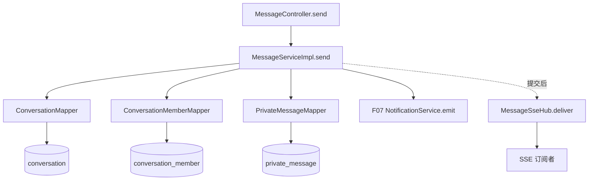

# F10 从代码学私信：幂等发送、未读与 SSE

按 `MessageController` → `MessageServiceImpl` → `ConversationMapper/ConversationMemberMapper/PrivateMessageMapper` → `WebSocketConfig.MessageSseHub` 读。类名 `WebSocketConfig` 易误导：当前对外实时通道是 **SSE**（`text/event-stream`），不是 WebSocket 双向协议；消息真值在 MySQL。

## 1. 三张表各管一件事

`conversation` 保存两人会话与最后一条消息；`conversation_member` 保存两个成员的未读数和已读位置；`private_message` 保存正文、发送人和客户端请求 ID。`pairKey=min(userA,userB)+":"+max(...)` 让 A→B 与 B→A 找到同一会话。`SendMessageDTO(clientMessageId,type,content)` 是客户端输入；真实 sender 来自 F01 `CurrentUserDTO`，不接收前端伪造的 senderId。`MessageVO` 不回传内部幂等字段。

## 2. 发送链，重点看两层幂等

`POST /api/messages/users/{targetId}` → `MessageController.send` → `MessageServiceImpl.send` 在 READ_COMMITTED 事务里：拒绝给自己发；`ConversationMapper.activeUser` 检查收件人；校验 `clientMessageId` 1～80、`type=TEXT`；Jsoup 去 HTML 后正文 1～4000 字 → 计算 `pairKey` → `PrivateMessageMapper.findByClientId(sender,clientId)`；若已发送，`checkedPrevious` 要求会话/类型/正文完全相同才返回旧消息，否则 `CLIENT_ID_REUSED`。

首次发送则 `ConversationMapper.findByPair`，没有会话就 `insert`，并 `ConversationMemberMapper.insert` 两名成员；并发建会话时唯一键只让一个成功，另一方重查复用。再 `PrivateMessageMapper.insert`；相同 client ID 并发重试撞唯一键时 `findByClientId` + `checkedPrevious`，**不再加未读**。新消息成功后 `ConversationMapper.touch` 更新最后消息，`ConversationMemberMapper.incrementUnread` 只加收件人未读，`NotificationService.emit` 发 F07 提醒。`TransactionSynchronization.afterCommit` 才调用 `MessageSseHub.deliver`；事务回滚时不会推一条不存在的消息。

## 3. 查询、已读和实时通道

`GET /api/messages/conversations` → `conversations` → `ConversationMapper.listFor(userId)`，只列自己参与的会话。`GET /api/messages/conversations/{id}?beforeId=...&size=20` → `history` → 私有 `requireMember` 通过 `ConversationMemberMapper.find` 防越权 → 校验 size 1～100、游标大于 0 → `PrivateMessageMapper.history` 按 id 游标读旧消息 → `toVo`。`PUT /conversations/{id}/read` → `read` → `requireMember` → `ConversationMemberMapper.markRead` 只更新当前用户成员行。

`GET /api/messages/stream` → `MessageController.stream` → `MessageSseHub.subscribe(userId)` 建立该用户的 `SseEmitter` 集合。发送提交后 `deliver(recipient,vo)` 只推在线连接；断线、服务器重启或用户离线时不会保留 SSE 事件，客户端需通过会话/历史接口补拉。SSE 是体验加速器，持久化私信才是事实来源。当前内存 Hub 只覆盖本进程，多实例跨节点实时推送还缺共享广播或粘性路由。

## 4. 方法地图

| 方法 | 作用 |
| --- | --- |
| `MessageController.send/conversations/history/read/stream` | HTTP/SSE 入口，取可信 user ID |
| `MessageServiceImpl.send` | 校验 → 幂等查旧 → 找/建会话 → 插消息 → 更新未读 → 通知 → 提交后 SSE |
| `conversations/history/read` | 会话卡片、游标历史、本人已读 |
| `requireMember/toVo/checkedPrevious/bad` | 成员授权、实体转响应、请求 ID 复用验证、参数异常 |
| `ConversationMapper.activeUser/findByPair/insert/touch/listFor` | 收件人、会话唯一键、最后消息、列表 SQL |
| `ConversationMemberMapper.insert/find/incrementUnread/markRead` | 成员与未读计数 SQL |
| `PrivateMessageMapper.findByClientId/insert/history/map` | 幂等键、消息写入、游标读取与行映射 |
| `MessageSseHub.subscribe/deliver/remove` | 连接登记、在线推送和断开清理 |

## 5. 面试时说清限制并自己验证

为什么不用 RabbitMQ 做私信真值？当前两人会话、未读和消息需要一次数据库事务，MySQL 三表和唯一键就能保证持久化与幂等；MQ 可用于将来多节点在线事件分发，但当前没有这个需求的实测证据。并发同会话首条消息、重复 `clientMessageId`、跨节点 SSE、消息严格有序是重点风险；现有游标按消息 id 读历史，不等于实时网络投递顺序有保证。

用 A/B 各发首条消息、重复同一 `clientMessageId`、再把旧 ID 配新正文；检查三表行数与 B 的未读。用 C 访问 A/B 会话历史应被拒。打开 B 的 SSE，A 发一条后断线重连，再用 `history` 补拉；对比“收到实时事件”和“数据库已经提交”的区别。
