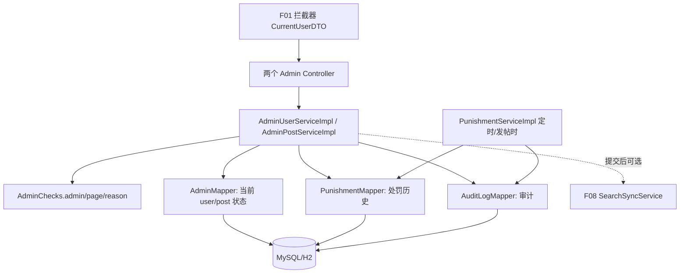

# F11 从代码学治理：权限、状态机、审计和禁言到期

先打开 `AdminUserController/AdminPostController`，再顺着 `AdminUserServiceImpl/AdminPostServiceImpl/PunishmentServiceImpl`，读 `AdminChecks` 和三个 Mapper。F01 拦截器只证明“请求是谁”，本包的 `AdminChecks.admin` 再判断是否 `ADMIN`；普通用户持有效 JWT 仍不能管理。

## 1. 当前状态在主表，历史在附表

`user_account.status` 是当前账号状态（`NORMAL/MUTED/BANNED`），`user_punishment` 留每次处罚或解除记录；`post.status` 是当前帖子状态（`PENDING/PUBLISHED/REJECTED/DELETED`）；`admin_audit_log` 记录操作者、动作、目标、前后值、理由和时间。列表 DTO/VO 不应把密码哈希、令牌版本等内部字段泄给前端。管理员请求中的 `reason` 由 `AdminChecks.reason` 限制非空且不超过 500 字。

## 2. 用户治理的请求链

`GET /api/admin/users` → `AdminUserServiceImpl.users` → `AdminChecks.admin/page` → 关键词转义后 `AdminMapper.users/userCount` → `toVo`。`PUT /api/admin/users/{id}/mute|ban|unban|unmute` → Controller 将固定动作字符串传给 `changeUser` → 管理员检查、理由检查 → 禁止处罚自己/管理员 → `AdminMapper.user` 查旧状态 → switch 求新状态 → 验禁言到期时间与允许的旧状态 → `AdminMapper.setUserStatus(id,oldStatus,newStatus,...)`；更新不到 1 行报 409，表示并发状态变化 → `PunishmentMapper.insert` → `AuditLogMapper.insert` → 可选 F08 `userChanged` → 重查用户并 `toVo`。状态、处罚、审计在同一数据库事务中。`BAN` 还由 SQL 增 `token_version`，使已有 JWT 失效；具体鉴权在 F01。`GET /{id}/punishments` 则先验管理员与目标，再 `PunishmentMapper.list`。

## 3. 帖子治理的请求链

`GET /api/admin/posts` → `AdminPostServiceImpl.posts` → `AdminChecks.admin/page` → 状态白名单 → `AdminMapper.posts/postCount` → `toVo`。`PUT /posts/{id}/approve|reject|delete` → `changeStatus`：先查旧帖；删除态不可再操作；批准/驳回只准 `PENDING` → 对照旧状态执行 `setPostStatus`，并发失败返回 409 → 管理删除还 `decrementTagsForPost` → `AuditLogMapper.insert` → 可选 F08 `postChanged` → 重查 VO。`PENDING → PUBLISHED/REJECTED` 是显式状态转换，不是任何人改一列即可。

`PUT /posts/{id}/top|essence` → `setFlag`：只允许已发布帖，`enabled` 必填；`TOP/ESSENCE` 在 Java switch 中映射固定列名 `is_top/is_essence`，客户端不能拼任意 SQL 列 → `AdminMapper.setPostFlag` → 写审计 → VO。`GET /api/admin/audit` → `audits` → `AuditLogMapper.list/count` → `toAuditVo`，仅管理员可读。置顶/精华改变展示标志，当前方法没有触发 F08 搜索同步；若 ES 排序依赖这些标志，需要另行验证索引是否滞后。

## 4. 到期解禁：后台任务与发帖检查共用

`PunishmentServiceImpl.expireDueMutes` 每 60 秒左右定时执行（配置可改）→ `PunishmentMapper.dueMuteIds(now,100)` 找仍 `MUTED` 且最近一条 MUTE 已到期的用户 → 对每人 `expireUserIfDue` → `clearExpiredMute` 只在当前仍禁言且最新禁言确已过期时更新为 `NORMAL` → 更新成功才追加 `EXPIRE_MUTE` 处罚和 operator=0 的系统审计。F03/F04 使用的 `PostingPermission.requireCanPost` 也可触发 `expireUserIfDue`，避免定时任务下一轮前仍误判禁言。条件 UPDATE 防多实例重复解除；一轮最多 100 人，量大时恢复有延迟。`expireDueMutes` 调同类方法，内部 `@Transactional` 不会再走一次代理，但外层定时方法自身已有事务；不能误以为每个用户单独提交。

## 5. 方法索引

| 方法 | 作用 |
| --- | --- |
| `AdminUserController.users/mute/ban/unban/unmute/punishments` | 用户治理路由 → `AdminUserService` |
| `AdminPostController.posts/approve/reject/delete/top/essence/audits` | 帖子治理路由 → `AdminPostService` |
| `AdminChecks.admin/page/reason/bad/missing` | 授权、页码、理由和统一异常 |
| `AdminUserServiceImpl.users/changeUser/punishments/toVo` | 当前用户查询、状态机、历史、VO |
| `AdminPostServiceImpl.posts/changeStatus/setFlag/audits/toVo/toAuditVo` | 后台帖、状态机、标记与审计 |
| `PunishmentServiceImpl.expireDueMutes/expireUserIfDue` | 扫描过期禁言、条件解禁 |
| `AdminMapper.user/users/userCount/setUserStatus/post/posts/postCount/setPostStatus/decrementTagsForPost/setPostFlag` | 当前状态及条件 SQL |
| `PunishmentMapper.insert/list/dueMuteIds/clearExpiredMute` | 历史与到期 SQL |
| `AuditLogMapper.insert/list/count` | 审计追加和分页 |

## 6. 选型和边界，自己验证

治理动作需要“状态与审计同时成功”，所以用同一 MySQL 事务比先异步写审计容易保证一致；条件 UPDATE 比只在 Java 读旧值更能阻止管理员并发覆盖。审计表是应用层追加，不是不可篡改审计系统；数据库高权限人员仍可修改。定时任务轮询简单，但扫描 100 人上限、延迟和多实例负载需要实测。当前没有证明大数据量下处罚表索引/扫描一定足够，也没有统一的状态机框架，规则分散在两个 Service。

练习：用普通 JWT 调后台接口；管理员禁言普通用户并尝试发帖；过期后同时触发发帖与定时任务，检查只出现一次 `EXPIRE_MUTE`；两个管理员同时审核同一待审帖，看一个成功、一个 409；删除帖子后比较普通列表、F08 搜索、F09 热门标签与审计记录。SQL 和响应一起核对，才能证明流程一致。
