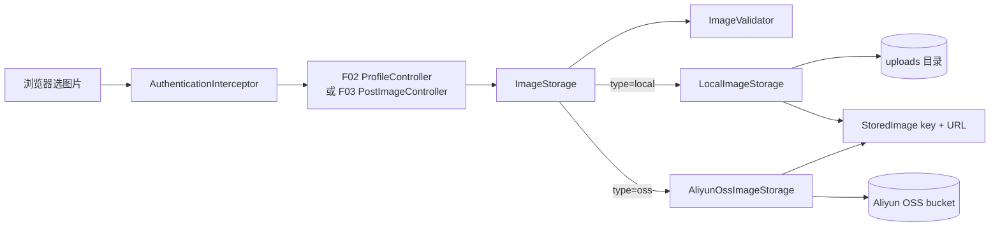

# F12 从前端到存储：本地与 OSS 图片链路

## 1. 先分清三个值

`MultipartFile` 是浏览器上传的原始输入；`objectKey` 是服务端生成的存储标识，例如 `avatars/7/uuid.png`；`url` 是浏览器读图片的地址。数据库存 URL，删除接口使用 object key。客户端文件名不能决定 key，否则容易覆盖文件或造成路径穿越。

## 2. 富文本图片请求链

前端编辑器 multipart `POST /api/posts/images` → `AuthenticationInterceptor.preHandle` 解析 JWT、查 `user_account`、校验 `token_version`/封禁并写入 `CurrentUserDTO` → `PostImageController.upload` 只使用这个可信 userId → `ImageStorage.store(file, POST, userId)` → `ImageValidator.validate` → 按当前月生成 `posts/yyyy/MM/uuid.ext` → 本地文件或 OSS `putObject` → 返回 wangEditor 所需 `{"errno":0,"data":{"url":"..."}}`。

这条链不写数据库；图片 URL 之后随帖子正文进入 F03。因此“上传成功但最后没发帖”会产生未引用图片，当前没有定时清理任务，这是明确的剩余边界。

## 3. 头像请求链与事务补偿

multipart `POST /api/profiles/me/avatar` → 拦截器 → `ProfileController.uploadOwnAvatar` → `ProfileServiceImpl.uploadOwnAvatar` 先读 `user_profile` 和旧 URL → `ImageStorage.store(file, AVATAR, userId)` 生成 `avatars/{userId}/uuid.ext` → `UserProfileMapper.updateById` 写新 URL。

文件系统/OSS 与 MySQL 没有共同 ACID 事务，所以 Service 注册 `TransactionSynchronization`：

- MySQL 提交：删除旧 URL 属于当前 `ImageStorage` 的对象。
- MySQL 回滚：删除刚上传的新 object key。
- 清理失败：记 warning，不把已成功的数据库事务伪装成失败。

这是补偿式一致性，不是分布式强事务；进程在写文件后、注册回调前崩溃仍可能留垃圾。

## 4. 校验真正在哪里

| 检查 | 位置 | 失败结果 |
| --- | --- | --- |
| 是否登录、token 版本、账号封禁 | `AuthenticationInterceptor.preHandle` | 401/403 |
| 非空、最大 20 MiB、MIME 白名单、图片可解码/WEBP 签名 | `ImageValidator.validate` | 400 |
| 服务端生成 key、根目录越界 | `LocalImageStorage.resolveKey` | 400 |
| OSS 必需配置 | `StorageConfiguration.ossClientFactory` | 启动失败 |
| 云端/磁盘异常不泄露内部信息 | 两个 `ImageStorage` 实现 | `STORAGE_UNAVAILABLE`, 503 |
| 头像 URL 写库必须影响 1 行 | `ProfileServiceImpl.uploadOwnAvatar` | 回滚 + 删新图 |

## 5. 本地与 OSS 的差异

`StorageConfiguration` 用 `@ConditionalOnProperty` 保证 Spring 容器中只有一个 `ImageStorage`。本地实现由 `WebMvcConfig` 把 `/uploads/**` 映射到配置根目录；OSS 实现每次操作创建客户端、在 `finally` 中 `shutdown`，使用 V4 签名。公开 URL 可以是 CDN 域名，没配时由 bucket 和 endpoint 推导。

练习：断点放在拦截器、Controller、`ImageValidator`、两个 `store`和头像事务 `afterCompletion`；分别传真 PNG、伪 PNG、超大图、未登录请求。如有自己的测试 bucket，再做真实上传/读取/删除；没有凭据时不要把 mock 通过写成“OSS 已联调”。
